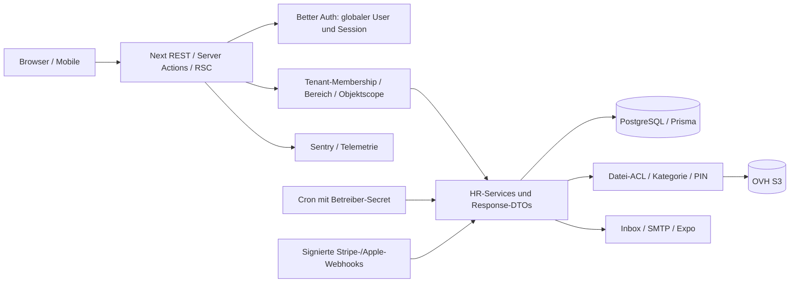

# Auditbericht – Ployo HR-SaaS

**Vertraulich – enthält konkrete Schwachstellen und interne Datenflüsse.**

Stand: **06.09.2026 (UTC)**. Prüfzeitraum: 05.–06.09.2026. Repository: `/opt/apps/ployo-front`. Referenz-Commit: `7afa0c5f5977292ed996a3c1ab5f462e14404598`.

**Phase 1: Analysieren → Verifizieren → Dokumentieren → Priorisieren.** Es wurden keine Anwendungscodes, Migrationen, Konfigurationen oder Dependencies geändert. Keine Produktions-/Fremdsysteme angegriffen, keine DB-Verbindungen für Tests aufgebaut, keine Daten gelöscht und keine Nachrichten versandt. Die beiden Auditdokumente sind die einzigen neuen Projektdateien dieses Audits; vorhandenes unversioniertes `tmp/` blieb unangetastet.

## A. Executive Summary

**Für einen uneingeschränkten produktiven Betrieb mit sensiblen HR-Daten bestehen Blocker.** Die Anwendung hat substanzielle Sicherheitsbausteine: zentrale Tenant-Guards, Rollen/Scopes, serverseitige Fachprüfungen, sichere Standard-Sessioncookies, Zwei-Faktor-Unterstützung, parametrisierte DB-Zugriffe, Feldverschlüsselung, Datei-ACLs, Virenscan, kurzlebige Downloads und Cleanup. Die Durchsetzung ist jedoch zwischen Initialisierung, REST, Server Actions, DTOs, Dokumentversionen und Jobs nicht konsistent.

Der Audit dokumentiert **38 Findings: 3 CRITICAL, 15 HIGH, 16 MEDIUM und 4 LOW**. Diese Anzahl zählt dokumentierte Ursachen-/Workflowgruppen, keine voneinander unabhängigen Exploits; verkettbare und überlappende Auswirkungen dürfen nicht addiert werden.

Die höchsten Risiken sind:

1. **C01:** Normales Einladungs-Onboarding kann Mitarbeiterrechte mit tenantweitem statt eigenem/teambezogenem Zugriff erzeugen.
2. **C02/C03:** Ein Zugangsentzug kann das globale Konto einschließlich fremder Tenant-Zugänge löschen; eine Schichtänderung kann fremde Tenant-Standorte verknüpfen und deren Metadaten offenlegen.
3. **H01–H05:** Rolleneskalation, zu mächtige Einstellungsrechte, überschreibbare Scopefilter, sensitive PATCH-Antworten und unzureichend geschützte Mutationsservices.
4. **H06–H09/H15:** Geschützte Dokumente lassen sich über alternative Wege verändern, sichtbar machen oder anhand von Metadaten erkennen; PIN-Cookies sind fälschbar, MIME-Vertrauen ermöglicht aktives HTML.
5. **H10–H14:** Urlaubsfreigaben sind umgehbar, Storage-Löschungen nicht zuverlässig, Aufbewahrungssperren umgehbar, Krankheitsbenachrichtigungen zu breit und die Next-Version von einem verifizierten DoS-Advisory betroffen.

**Sofortige Priorität:** Tenant-/Rollen-/Dateigrenzen schließen, bestehende Fehlberechtigungen ermitteln, den betroffenen Next-Release ablösen und Löschabläufe bis zur verlässlichen Frist-/Fehlerbehandlung absichern. Bereits produktiv vorhandene Fehlberechtigungen und möglicherweise verwaiste Storage-Objekte müssen kontrolliert untersucht werden; keine pauschale Massenlöschung. Festgestellte Schwachstellen allein belegen noch keinen Datenschutzvorfall.

Zwölf isolierte Checks reproduzierten konkrete Originalcodepfade; 55 bestehende reine Tests aus acht Dateien bestanden. Das ist kein Penetrationstest eines Deployments und kein Nachweis vollständiger Sicherheitsfreiheit. Der vollständige npm-Advisory-Scan scheiterte an DNS; einzelne relevante Hersteller-Advisories wurden separat geprüft. Rechtsrisiken werden anhand der tatsächlichen Funktionen beurteilt, ohne aus fehlender Repository-Dokumentation automatisch einen Rechtsverstoß abzuleiten.

### Prüfmaßstab und Nachweisgrenzen

**CONFIRMED**: Daten-/Kontrollfluss im Code nachvollziehbar; die Auswirkung kann weiterhin bestimmte Rollen, IDs, Nutzerinteraktion oder Deploymentbedingungen voraussetzen. **LIKELY**: starkes Indiz, wesentlicher Teil ungeprüft. **POTENTIAL**: theoretisches Szenario. Confidence bewertet die Evidenz, Severity die konkrete Reichweite, Erreichbarkeit und Datensensibilität. Rechtliche Einordnung unterscheidet technischen Fehler, konkretes Compliance-Risiko und nutzungs-/konfigurationsabhängige Zulässigkeit.

Alle Findings unten sind auf Codeebene CONFIRMED; dies bedeutet ausdrücklich weder „in Produktion ausgenutzt“ noch „rechtskräftig festgestellter Rechtsverstoß“. Unbelegte Betriebs-/Vertragsfragen stehen in L als **NICHT VERIFIZIERBAR – manuelle Prüfung erforderlich**. Nicht bestätigte Angriffskandidaten stehen in K/Anhang 4 und wurden nicht als HIGH/CRITICAL gezählt.

Untersucht wurden die 489 versionierten Projektdateien als Inventar, davon insbesondere **111 API-Routendateien**, **14 `actions.ts`**, **42 Prisma-Modelle**, **44 Migrationen**, Frontend-/RSC-Einstiegspunkte, Services, relevante installierte SDK-Pfade, Tests, Lockfile, Skripte und Konfiguration. Generierte Buildkopien, `node_modules` und unversionierte Altarbeitsverzeichnisse wurden nicht als eigenständige Anwendungssourcen vollständig auditiert; installierte Bibliotheksimplementierungen wurden gezielt für streitige Sicherheitsannahmen gelesen. Kein vollständiger Git-History-Secret-Scan, kein Beweis über alle möglichen Laufzeitpfade.

## B. System Architecture

| Ebene | Tatsächlich erkannt | Sicherheitsgrenze |
|---|---|---|
| Anwendung | TypeScript, Next.js 16.2.9 App Router, React 19.2.4, next-intl; RSC, Client-Komponenten, REST, Server Actions | Browser/mobile Clients sind untrusted; Page-/Layout-Schutz ersetzt keinen Service-Guard |
| Backend | Gemeinsamer Next/Node-Prozess, `lib/*-service.ts`; Prisma 6.19.3/PostgreSQL | Zentrale DB-/Storage-Zugangsdaten; Anwendung muss Objekt- und Tenant-Scope durchsetzen |
| Identität | Better Auth 1.6.27, E-Mail/Passwort, Google/Apple OAuth, Zwei-Faktor-Plugin, Expo-Integration | Globaler User/Account/Session gegenüber tenantgebundener Membership/Personalakte |
| Autorisierung | OWNER/ADMIN/HR/EMPLOYEE plus eigene Rollen, Bereich, Level, own/team/assigned/all, Flags | Legacy-Verwalter bewusst weit privilegiert; Custom-Rollen benötigen vollständige Scopeprüfung |
| Sessions | 7 Tage Laufzeit, Aktualisierung nach 1 Tag, Cookie-Cache 5 Minuten; sichere Prod-Cookieflags | DB-Widerruf vs. Cache; tenantbezogenes MFA-Erfordernis wird in Guards geprüft |
| Dateien | Prisma-Metadaten, OVH-S3-kompatibler HR-Bucket, AES-GCM-Feldschutz, ACL, PIN, ClamAV | Logische Dokumentrechte müssen Stream, Signed URL, Self-Service, Metadaten und Versionen gleichermaßen schützen |
| Verarbeitung | Synchrone Services, DB-Transaktionen, Benachrichtigungsdispatch; HTTP-Cron Cleanup/Notifications | Kein separater dauerhafter Queue-/Outbox-Dienst gefunden; Nebenwirkungen können von DB-Zustand abweichen |
| Betrieb | PM2-orientierte Deploy-/Rollback-Skripte, GitHub Actions, PostgreSQL-Testservice | Tatsächliche PM2-/Proxy-/Cloud-/Backup-Konfiguration nicht vollständig im Repository |
| Integrationen | SMTP, OVH S3, Sentry, Google, Apple/JWKS/Revoke, Expo/APNS/FCM, Stripe | Empfänger, Verträge, Regionen und Löschung außerhalb der App separat prüfen |

Mandantentrennung beruht überwiegend auf `tenantId` in Queries. Es wurden keine durchgängige PostgreSQL-RLS und keine durchgängigen zusammengesetzten Tenant-FKs gefunden. Einzelne Queries nur mit `employeeId` sind nicht automatisch IDOR: wenn die ID vorher autorisiert aufgelöst und unveränderlich übernommen wird, ist das ein gültiger Schutz. C03 belegt die konkrete Lücke bei einer neu zugewiesenen Relation.

## C. Data Map

Das folgende Modell wurde vor der Finding-Bewertung als Arbeitsgrundlage verwendet und gegen Exporte, Jobs und alternative API-Wege abgeglichen. Angaben beschreiben technisch mögliche gespeicherte Daten, nicht den Inhalt realer Kundenakten.

| Datentyp | Quelle → API/Backend | DB / Storage | Drittanbieter | Frontend → Export / Löschung |
|---|---|---|---|---|
| Identität, Name, E-Mail, Passwort-Hash, OAuth-IDs/-Tokens | Registrierung/Login/Einladung → Better Auth, account-service | User, Account, Verification, TwoFactor | Google/Apple; SMTP für Verifikation/Reset | Konto/Session-UI; Kontoexport; eigener und SDK-Löschpfad (C02/M07) |
| Sessiontoken, Loginzeit, IP, User-Agent | HTTP/Auth → Better Auth | Session, RateLimit, AppRateLimit | Hosting; Fehlerkontext potenziell Sentry | Sitzungsverwaltung; Ablauf/Cleanup; Cache-Widerruf M09 |
| Stammdaten: Personalnummer, Geburt, Kontakt, Familienstand, Nationalität, Steuer-ID, SV-Nr., Krankenkasse, IBAN | HR-Formular/Self-Service → employee-service | TenantEmployee; sensible Teilfelder verschlüsselt | Benachrichtigung/Monitoring nur soweit jeweiliger Payload | Mitarbeiterakte/Listen/PATCH; HR-/Tenant-Export; Retention (H04/M05/M06) |
| Private/Arbeitsadresse, Notfallkontakte | HR/Self-Service → employee-service/address | EmployeeAddress; emergencyContactsJson; teilweise verschlüsselt | Kein dedizierter Adressdienst gefunden | Akte/Export; Anonymisierung und Employee-Delete |
| Verträge, Vergütung, Vertragsende/-grund, Arbeitszeit-/Urlaubswerte | HR → contract-service bzw. manuelle ContractDetails | TenantEmployeeContract, TenantEmployeeContractDetails, TenantFile + S3 | OVH | Vertrag/PDF; getrennte Export-/Fristpfade (M02/M04/M12) |
| Brutto/Netto, Gehaltsabrechnung | HR-Upload → payroll-service | TenantPayrollStatement + TenantFile/S3 | OVH | Fachbereich/Self-Service; Payroll-Export; gesetzlich zu differenzierende Retention |
| Krankheit, Zeitraum, Freitext, AU-/sonstige Anhänge | Eigenmeldung/HR → sickness/self-service | TenantSicknessReport, TenantFile/S3 | SMTP/Expo bei Konflikt, Sentry bei Fehlern | Krankheit/Plan/Reminder; eigene Metadaten-/Notiz-/Dateilöschpfade (H14/M05/M16) |
| Mutterschutzstatus/-notiz | HR → employee-service | TenantEmployee; Notiz verschlüsselt | Kein dedizierter externer Dienst gefunden | Fachrecht mutterschutz; Planungsregeln, DTO/Export (H04/M03) |
| Urlaub, Wunschfrei, Notizen, Entscheider, Datum | Self-Service/HR → vacation-/wish-free-service | TenantVacationRequest, TenantWishFreeRequest | Benachrichtigungen SMTP/Expo | Kalender/Saldo; Export/Änderung/Entscheidung (H10/M01/M02) |
| Geplante Schichten, Pausen, Team/Standort, Sollstunden | Planung/Templates → shift-service | TenantShift, TenantShiftTemplate, TenantShiftWeek JSON | Benachrichtigungen | Plan/Veröffentlichung/Snapshots; Tenant-Export unvollständig; keine tatsächlichen Zeitstempel einer Zeiterfassung gefunden |
| Team-/Standortzuordnung, Leitung, kopierte Namen | HR → team/location-services | Team/Location/Member/Activity, Employee-Strings | Einzelne Benachrichtigungen | Verzeichnis/Plan; Datenkopien bei Retention relevant |
| Beliebige HR-Dokumente, Titel, Beschreibung, ACL, Version, Ordner | Upload → storage.service → ClamAV → S3 | TenantFile, TenantFileFolder, FolderTemplate; Objektbytes | OVH, lokaler ClamAV | Metadaten, Stream, signed URL (default 5 Min), Token (default 120 s, Vorschau länger); Purge (H06–H09/H11/H15) |
| Erinnerungen, Anfragen, Antworten, Historie | HR/Self-Service → reminders/employee-service | TenantReminder, InfoRequest, Timeline, EmployeeNotification | SMTP/Expo; Sentry-Fehlerkontext | Inbox/Wiedervorlage/Akte; eingeschränkte Export-/Retentionabdeckung |
| Push-Token, Benachrichtigungstext, gelesen/ungelesen, Präferenzen | App/Dispatch → notifications | PushSubscription, UserPreference, Inbox-/Notificationmodelle | Expo → APNS/FCM; SMTP | App-Benachrichtigung; Bereinigung nur teilweise (M05/M11) |
| Rollen, Einladungen, Mitglieder, Entscheider-/Auditnamen | Tenantverwaltung/HR → roles/settings/audit | TenantMembership, TenantRolePermission, TenantInvitation, TenantAuditLog | SMTP bei Einladung | Administration; Audit-TTL tenantkonfiguriert; Token-/Altbestände separat prüfen |
| Consentwert/-version, IP/UA; Seitenaufrufpfad/Referrerhost | Banner/öffentliche Website → consent/analytics | ConsentRecord; PageView ohne gespeicherte User-ID | Sentry für getrennte Fehler/Tracing/Replay-Zwecke | Banner/Betreiber-Statistik; PageView-Cleanup vorhanden, Consent-TTL fehlt |
| Kunden-/Subscription-/Rechnungsbezüge | Billing → Stripe-SDK/Webhook | Stripe-IDs/Status/Plan an Tenant | Stripe | Billing-Portal/Rechnungen; Provider-Retention organisatorisch prüfen |

**Nicht als dedizierte Funktion/strukturierte Felder gefunden:** Bewerbermanagement, Lebenslauf-Pipeline, KI-Bewertung/Profiling, automatische Einstellungs-/Kündigungsentscheidung, Leistungs-/Disziplinarbewertung, Behinderungsregister, Identitätsprüfung, GPS-/Gerätefingerprinting, Arbeitnehmerüberlassungsverwaltung, eAU-Abruf, eigentliche Lohnberechnung und Ist-Zeiterfassung. Freitexte/Uploads können solche Daten dennoch enthalten; tatsächliche Inhalte: **NICHT VERIFIZIERBAR – manuelle Prüfung erforderlich**. Standortdaten bezeichnen hier vor allem Betriebsstandorte/Zuordnungen, nicht nachgewiesenes Live-Tracking.

## D. Attack Surface

Extern erreichbar sind Login/Registrierung/OAuth/Reset/Einladung, Better-Auth-Catch-all, Kontakt, Consent, öffentliche Seitenstatistik, Health, Next-Parser/Image-Optimizer und Sentry-Tunnel. Authentifizierte Angriffsflächen umfassen alle `/api/me/*`, Tenant-APIs, Server Actions und geschützten RSC-Datenabfragen. „me“ im Pfad bedeutet nicht automatisch Self-Service: `/api/me/team-shifts/*` führt Manageroperationen aus.

Betreiberzugriffe: Cleanup/Notifications-Cron und Analytics-Summary mit `CRON_SECRET`. Drittanbieterzugriffe: signierter Stripe-Raw-Body und Apple-JWT mit Issuer/Audience/JWKS-Prüfung. Storage ist über authentifizierte App-Wege und befristete Bearer-URLs erreichbar; öffentliche Bucket-Policies konnten nicht verifiziert werden. Interne Angriffsfläche sind gemeinsame DB-/S3-Credentials, Scripts, CI, Logs und Schlüsselrotation.

Einladungs- und Datei-IDs dürfen als bekannt angenommen werden; UUIDs sind keine Autorisierung. Der Bericht behauptet keine erratbare UUID-Enumeration, wenn lediglich eine bekannte ID benötigt wird. Mass Assignment wird durch Input-Whitelists teilweise mitigiert; H01 betrifft ein ausdrücklich zugelassenes, aber zu mächtiges Feld. Replay-/Race-Risiken wurden insbesondere bei Urlaub, Dateiversionen und Billing verfolgt.

## E. Critical Findings

### [C01] Erste Mitarbeiter-Einladung erzeugt Berechtigungen mit Scope „all“

**Kategorie:** Security / Datenschutz  
**Severity:** CRITICAL · **Confidence:** HIGH · **Status:** CONFIRMED

**Fundstelle:** `lib/invitation-service.ts:131–162,173–237`; `lib/roles.ts:237–279`; `lib/role-service.ts:124–174`; `lib/tenants.ts:264–336`; `prisma/schema.prisma:506`

**Betroffene Funktion / Endpoint:** Einladungsannahme /invite/[token]; anschließend tenantbezogene HR-APIs

**Problem:** Wird die EMPLOYEE-Rolle beim Annehmen einer Einladung erstmals angelegt, erhält sie gegenüber dem vorgesehenen Mitarbeiter-Template wesentlich weitere Zugriffe. Betroffen sind unter anderem sensible Stammdaten, Verträge, Abrechnungen und Abwesenheiten im gesamten eigenen Mandanten.

**Technische Ursache:** Der Create-Zweig erzeugt Permission-Zeilen nur mit area und level. Prisma ergänzt scope mit dem Default all. Das reguläre Template verwendet für sensible Bereiche own und für das Mitarbeiterverzeichnis team. Die Tenant-Anlage initialisiert diese Rollen nicht; spätere Upserts mit update: {} reparieren sie nicht.

**Angriff / Fehlerszenario:** Neuen Tenant anlegen, Mitarbeiter einladen und annehmen lassen, bevor der alternative Rolleninitialisierungspfad gelaufen ist. Der eingeladene Mitarbeiter ruft danach Daten anderer Beschäftigter desselben Tenants ab.

**Auswirkung:** Breiter Zugriff auf besonders schützenswerte HR-Daten bei einem gewöhnlichen Onboarding-Pfad. Kein behaupteter Cross-Tenant-Read; CRITICAL wegen Reichweite und niedrigem Berechtigungsniveau.

**Datenschutz-/Rechtsbezug:** Art. 5 Abs. 1 lit. c/f, Art. 25 und 32 DSGVO; bei Gesundheitsdaten zusätzlich Art. 9. Dies ist eine technische Risikozuordnung, kein Nachweis einer bereits erfolgten Offenlegung.

**Beweis:** Isolierter Aufruf der tatsächlichen Einladungslogik erzeugte sämtliche Permission-Einträge ohne scope, einschließlich sensitiveData=read. Schema-Default separat geprüft.

**Empfohlene Behebung:** Ein einziges kanonisches Rollen-Template einschließlich Scope und Flags verwenden; Rollen bei Tenant-Anlage atomar initialisieren. Bestehende so erzeugte Rollen identifizieren und nach Abgleich mit bewusst angepassten Rollen korrigieren.

**Regressionstest:** Frischer Tenant ohne Rollen → Einladung annehmen → effective permissions entsprechen exakt dem Template; fremde Gehalts-/Gesundheitsdaten bleiben gesperrt. Beide Initialisierungsreihenfolgen testen.

### [C02] Mandantenbezogener Zugangsentzug löscht das globale Benutzerkonto

**Kategorie:** Security / Datenschutz / Architektur  
**Severity:** CRITICAL · **Confidence:** HIGH · **Status:** CONFIRMED

**Fundstelle:** `lib/employee-service.ts:2251–2305`; `lib/account-service.ts:95–149`; `app/api/tenants/[tenant]/employees/[employeeHandle]/access/route.ts`

**Betroffene Funktion / Endpoint:** DELETE /api/tenants/[tenant]/employees/[employeeHandle]/access

**Problem:** Ein berechtigter Verwalter in Tenant A kann beim Entzug des Mitarbeiterzugangs auch die Zugänge desselben Users in Tenant B beseitigen.

**Technische Ursache:** deleteEmployeeAccess ruft deleteUserAccessImmediately(employee.userId) auf. Dieser Helper entkoppelt Mitarbeiter über userId in allen Tenants und löscht User global mit abhängigen Accounts, Sessions und Memberships. Die Sperre gegen das Löschen eines alleinigen Owners ersetzt keine Autorisierung für andere Tenants.

**Angriff / Fehlerszenario:** User ist Beschäftigter in A und B und kein durch die Sole-Owner-Regel geschützter Benutzer. HR in A entzieht den Zugang des Mitarbeiters in A.

**Auswirkung:** Erreichbarer Cross-Tenant-Schreib-/Löschvorgang, Verlust weiterer Zugänge und persönlicher Kontodaten. Kein Passwort oder Recht in B erforderlich.

**Datenschutz-/Rechtsbezug:** Art. 5 Abs. 1 lit. c/f, Art. 25 und 32 DSGVO; bei Gesundheitsdaten zusätzlich Art. 9. Dies ist eine technische Risikozuordnung, kein Nachweis einer bereits erfolgten Offenlegung.

**Beweis:** Der lokale Mock beobachtete den unbeschränkten userId-Unlink und globale User-Löschung; Aufrufkette und Kaskaden im Schema nachvollzogen.

**Empfohlene Behebung:** Mandantenentzug auf genau die Membership und Mitarbeiter-Verknüpfung in A begrenzen. Globale Kontolöschung ausschließlich als gesonderten, authentifizierten Kontoinhaber-/Betreiberprozess ausführen.

**Regressionstest:** Ein User in zwei Tenants: Entzug in A lässt Account, Membership B, OAuth-Verknüpfungen und B-Daten intakt. Sole-Owner-Sonderfälle und geplante Löschung getrennt testen.

### [C03] Schicht-Update akzeptiert Standort-ID eines fremden Mandanten

**Kategorie:** Security / Architektur  
**Severity:** CRITICAL · **Confidence:** HIGH · **Status:** CONFIRMED

**Fundstelle:** `lib/shift-service.ts:1257–1326,544–566,1408`; `lib/location-service.ts:444–446`; `app/api/me/team-shifts/[shiftId]/route.ts:34–66`; `prisma/schema.prisma`

**Betroffene Funktion / Endpoint:** PATCH /api/me/team-shifts/[shiftId]

**Problem:** Eine Schicht in Tenant A lässt sich mit einem Standort in Tenant B verknüpfen. Nachfolgende Includes überschreiten damit die Mandantengrenze.

**Technische Ursache:** Schicht und Mitarbeiter werden tenantgebunden gesucht, locationId im Update dagegen direkt übernommen. Die einfache Fremdschlüsselrelation erzwingt nur die Existenz des Standorts. Der Create-Pfad prüft den Standort korrekt; das mitigiert den Update-Pfad nicht.

**Angriff / Fehlerszenario:** Ein Nutzer mit Schicht-Schreibrecht in A kennt eine Standort-ID aus B und setzt sie per PATCH. Der Plan in A lädt den fremden Standort. Die Rückrelation beim Standort in B kann die fremde Schicht einbeziehen.

**Auswirkung:** Cross-Tenant-Offenlegung von Standortname/-farbe/-ID sowie Schicht-/Mitarbeiter-IDs über Rückrelationen. Bekannte fremde ID ist Voraussetzung; kein Nachweis eines Zugriffs auf komplette Personalakten. CRITICAL entsprechend der angeforderten Priorisierung tatsächlich erreichbarer Mandantengrenzverletzungen.

**Datenschutz-/Rechtsbezug:** Art. 5 Abs. 1 lit. c/f, Art. 25 und 32 DSGVO; bei Gesundheitsdaten zusätzlich Art. 9. Dies ist eine technische Risikozuordnung, kein Nachweis einer bereits erfolgten Offenlegung.

**Beweis:** Isolierter Aufruf von updateTenantShift übergab die fremde locationId unverändert an Prisma; kein Standort-Lookup. Relation und nachfolgende Includes statisch geprüft.

**Empfohlene Behebung:** Location per id UND authenticated tenant auflösen. Tenantkonsistenz für alle Relationen ergänzen, möglichst über zusammengesetzte FKs; Rückrelationen zusätzlich tenantgebunden lesen.

**Regressionstest:** Zwei Tenants und Standorte: fremde locationId bei Create/Update/Template/Reset ablehnen; keine fremden Metadaten in Plan, Standortdetails oder veröffentlichten Snapshots.

## F. High Findings

### [H01] Mitarbeiterprofil kann die eigene Berechtigungsrolle hochstufen

**Kategorie:** Security  
**Severity:** HIGH · **Confidence:** HIGH · **Status:** CONFIRMED

**Fundstelle:** `lib/employee-service.ts:1824,1934–1944,2061,2137`; `lib/api/employee-input.ts:83–90`; `lib/role-service.ts:232–259`; `lib/roles.ts:154–176`

**Betroffene Funktion / Endpoint:** PATCH /api/tenants/[tenant]/employees/[employeeHandle] und Mitarbeiter-Server-Action

**Problem:** Das editierbare fachliche Feld role verändert die echte TenantMembership.roleId, ohne Rollenadministration zu verlangen.

**Technische Ursache:** updateTenantEmployee verlangt employees:write und Objektscope. Ein gültiger Rollenname wird anschließend über syncEmployeeRoleToMembership in eine Berechtigungsrolle umgesetzt. Ein gesonderter roles-/Admin-Guard fehlt in dieser Kette.

**Angriff / Fehlerszenario:** Eine benutzerdefinierte Rolle erlaubt dem Nutzer die Bearbeitung der eigenen Akte, aber keine Rollenverwaltung. Er setzt role auf HR-Leitung und erhält deren weitergehende Permissions.

**Auswirkung:** Vertikale Privilegieneskalation bis zur Rollen-/Einstellungsverwaltung. Voraussetzung ist employees:write; ein unveränderter gewöhnlicher Read-only-Mitarbeiter hat dieses Recht nicht.

**Datenschutz-/Rechtsbezug:** Art. 5 Abs. 1 lit. c/f, Art. 25 und 32 DSGVO; bei Gesundheitsdaten zusätzlich Art. 9. Dies ist eine technische Risikozuordnung, kein Nachweis einer bereits erfolgten Offenlegung.

**Beweis:** Der echte Synchronisationshelper setzte im Mock unmittelbar die hochprivilegierte roleId. REST-Whitelist, Service-Guard und Aufruferkette separat geprüft.

**Empfohlene Behebung:** Fachliche Berufsrolle und Autorisierungsrolle trennen. Membership-Änderungen nur über einen zentralen Rollenadministrator-Service mit zulässiger Delegation und Audit durchführen.

**Regressionstest:** Custom employees:write/own ohne roles-Recht darf role nicht auf HR-Leitung/Administrator ändern; Identitäts- und Rollenänderungen über REST und Action testen.

### [H02] Einstellungsrecht ermöglicht Admin-Einladungen und vollständigen HR-Export

**Kategorie:** Security / Datenschutz  
**Severity:** HIGH · **Confidence:** HIGH · **Status:** CONFIRMED

**Fundstelle:** `lib/settings-service.ts:174–220,439–447`; `lib/tenant-export.ts:17–79`; `app/api/tenants/[tenant]/invitations/route.ts`; `app/api/tenants/[tenant]/export/route.ts`

**Betroffene Funktion / Endpoint:** POST /api/tenants/[tenant]/invitations; GET /api/tenants/[tenant]/export

**Problem:** Eine benutzerdefinierte Rolle mit settings:write kann ADMIN/HR einladen und den weitreichenden Tenant-Export erhalten, obwohl ihr die betreffenden Fachrechte fehlen.

**Technische Ursache:** requireSettingsManager prüft settings:write. Die Folgeschritte binden privilegierte Einladungsrollen nicht an die delegierbaren Rechte des Actors; der Export prüft keine separaten sensiblen Bereiche bzw. dedizierte Exportberechtigung.

**Angriff / Fehlerszenario:** Ein Einstellungen-Bearbeiter lädt ein zweites von ihm kontrolliertes Konto als ADMIN ein oder exportiert Personal- und Abrechnungsdaten unmittelbar.

**Auswirkung:** Admin-Eskalation und tenantweite HR-Offenlegung. Ob settings:write absichtlich einem Volladministrator vorbehalten ist, ändert nichts an der technischen Kopplung; Custom-Rollen suggerieren unabhängige Bereiche.

**Datenschutz-/Rechtsbezug:** Art. 5 Abs. 1 lit. c/f, Art. 25 und 32 DSGVO; bei Gesundheitsdaten zusätzlich Art. 9. Dies ist eine technische Risikozuordnung, kein Nachweis einer bereits erfolgten Offenlegung.

**Beweis:** Der Manager-Guard verlangt ausdrücklich requireTenantAccess(tenantSlug, "settings", "write"); dieselbe Autorisierung wird für Invitation und buildTenantExport verwendet.

**Empfohlene Behebung:** Einladungs-/Rollenadministration und Voll-Export als explizite Fähigkeiten modellieren; keine Vergabe höherer Rechte als selbst delegierbar. Exportauswahl und Output nach Fachrechten filtern.

**Regressionstest:** Custom settings:write ohne Rollen-/HR-Rechte kann weder ADMIN einladen noch Payroll/SensitiveData exportieren; berechtigte Owner-Pfade bleiben möglich.

### [H03] Zusatzfilter überschreiben Own-Scope; leerer Team-Scope wird erweitert

**Kategorie:** Security / Datenschutz  
**Severity:** HIGH · **Confidence:** HIGH · **Status:** CONFIRMED

**Fundstelle:** `lib/employee-service.ts:779–797,896–915,991–994`; `lib/tenant-access.ts:431–526`

**Betroffene Funktion / Endpoint:** GET /api/tenants/[tenant]/employees mit Filtern; weitere teamgebundene HR-Listen

**Problem:** Die Kombination von Berechtigungs- und Suchfiltern kann den zuvor gesetzten Objektscope entfernen. Team-Nutzer ohne zugeordnetes Mitarbeiterteam können statt einer leeren Menge Datensätze mit leerem Team erhalten.

**Technische Ursache:** {...scope, ...filter} lässt ein vom Standortfilter erzeugtes id: {in: ...} das id=self des Own-Scopes ersetzen. Separat wird ein fehlendes Team als leerer String in Listenbedingungen verwendet. Der strengere scopeAllowsTarget-Helper wird nicht überall benutzt.

**Angriff / Fehlerszenario:** Own-Benutzer filtert auf einen Standort mit mehreren Beschäftigten. Alternativ nutzt ein Team-Benutzer ohne Teamzuordnung die Mitarbeiter-/Abwesenheitslisten.

**Auswirkung:** Unberechtigte Daten anderer Beschäftigter innerhalb desselben Tenants; je nach Liste auch Abwesenheiten.

**Datenschutz-/Rechtsbezug:** Art. 5 Abs. 1 lit. c/f, Art. 25 und 32 DSGVO; bei Gesundheitsdaten zusätzlich Art. 9. Dies ist eine technische Risikozuordnung, kein Nachweis einer bereits erfolgten Offenlegung.

**Beweis:** Der isolierte Check komponierte die tatsächlichen Filterhelper wie Zeile 994: id=self wurde durch id IN [self,other] ersetzt.

**Empfohlene Behebung:** Berechtigungsfilter und Nutzersuche ausschließlich mit AND verknüpfen; fehlende Scope-Zuordnung muss eine leere Menge ergeben. Gemeinsame Query-Builder für alle Listen verwenden.

**Regressionstest:** Own+Standortfilter enthält ausschließlich den eigenen Datensatz; Team ohne Zuordnung liefert null Treffer. Kombinatorik mit Suche, Pagination und leeren Teamwerten testen.

### [H04] PATCH-Antwort enthält sensible Felder trotz fehlender Leseberechtigung

**Kategorie:** Security / Datenschutz  
**Severity:** HIGH · **Confidence:** HIGH · **Status:** CONFIRMED

**Fundstelle:** `lib/employee-service.ts:585,676–693,1860–1922,1940,2126–2175`; `app/api/tenants/[tenant]/employees/[employeeHandle]/route.ts:97`

**Betroffene Funktion / Endpoint:** PATCH /api/tenants/[tenant]/employees/[employeeHandle]

**Problem:** Ein Benutzer mit Recht zur Bearbeitung allgemeiner Mitarbeiterdaten erhält aus der Update-Antwort unter anderem entschlüsselte sensible Stammdaten und Mutterschutzinformationen, obwohl entsprechende Fachrechte fehlen.

**Technische Ursache:** Der Service entfernt unberechtigte Eingabefelder, verwendet beim Rückgabewert aber toEmployee mit permissiven Standardwerten. Die GET-Projektion wird nicht durchgängig wiederverwendet.

**Angriff / Fehlerszenario:** Berechtigter Profilbearbeiter ohne sensitiveData-/Mutterschutz-Recht sendet eine harmlose Telefonnummernänderung und liest die vollständige Update-Antwort.

**Auswirkung:** Offenlegung beispielsweise von IBAN, Sozialversicherungsdaten, privaten Angaben und Mutterschutzhinweisen, soweit gespeichert. Nicht pauschal jedes Gehaltsfeld: Vertragsdatei-/DTO-Bedingungen begrenzen Teilfelder.

**Datenschutz-/Rechtsbezug:** Art. 5 Abs. 1 lit. c/f, Art. 25 und 32 DSGVO; bei Gesundheitsdaten zusätzlich Art. 9. Dies ist eine technische Risikozuordnung, kein Nachweis einer bereits erfolgten Offenlegung.

**Beweis:** Input-Filter schützen nur Schreibfelder; toEmployee(record) aktiviert standardmäßig sensible Outputfelder; Route gibt Service-Ergebnis zurück.

**Empfohlene Behebung:** Einheitlichen Actor- und Scope-abhängigen Response-DTO für GET, POST, PATCH und Server Actions verwenden; Default für sensible Felder auf ausgeschlossen setzen.

**Regressionstest:** Custom Profilbearbeiter führt leeren/harmlosen PATCH aus: dieselben sensitiven Felder fehlen wie bei GET. Tests für alle Feldbereiche und Antwortpfade.

### [H05] Mehrere Mutationsservices erzwingen den Objektscope nicht

**Kategorie:** Security / Business Logic  
**Severity:** HIGH · **Confidence:** HIGH · **Status:** CONFIRMED

**Fundstelle:** `lib/shift-service.ts:1164–1430`; `lib/team-service.ts:569–698`; `lib/location-service.ts:739,827,934,1123`; `lib/employee-service.ts:2356–2410,2604–2657,2718–2831`; `lib/vacation-service.ts:605–631`; `lib/reminders.ts:468–563`; `app/(dashboard)/u/[tenant]/teams/actions.ts:64–149`

**Betroffene Funktion / Endpoint:** Schicht-REST/Actions; Team-/Standort-/Mitarbeiter-Actions; PATCH/DELETE info-requests/[requestId]; DELETE vacation-requests/[requestId]; PATCH reminders/[reminderId] und POST complete

**Problem:** Bereichsrechte und tenantId sind vorhanden, die Einschränkung auf own/team/assigned wird in mehreren Schreibpfaden jedoch nicht auf das Zielobjekt angewendet.

**Technische Ursache:** Die Services verwenden tenantgebundene ID-Abfragen ohne den Scopefilter aus den Lesepfaden. Einige REST-Handler laden vorab mit getTeamForTenant/getLocationForTenant/getEmployeeForTenant und sind dadurch eingeschränkt; direkt aufrufbare Server Actions übergeben Form-IDs ohne diese Vorprüfung.

**Angriff / Fehlerszenario:** Custom Team-Verwalter ändert über eine Server Action die ID auf ein fremdes Team desselben Tenants. Schicht-Verwalter mit begrenztem Scope verändert fremde Schichten; entsprechend lassen sich fremde Erinnerungen oder Info-Anfragen bearbeiten.

**Auswirkung:** Horizontale Rechteüberschreitung und Manipulation von HR-/Planungsdaten. Tenantfilter verhindern bei diesen konkreten Pfaden grundsätzlich den direkten Zugriff auf einen anderen Tenant; C03 ist die gesonderte Relation-Ausnahme.

**Datenschutz-/Rechtsbezug:** Art. 5 Abs. 1 lit. c/f, Art. 25 und 32 DSGVO; bei Gesundheitsdaten zusätzlich Art. 9. Dies ist eine technische Risikozuordnung, kein Nachweis einer bereits erfolgten Offenlegung.

**Beweis:** Vergleich der read-scope Query-Builder mit den oben genannten Write-Queries und den direkten Action-Aufrufern. Vorprüfungen in den REST-Team-/Standort-Routen ausdrücklich als Gegenbeweis berücksichtigt.

**Empfohlene Behebung:** Objekt- und Beziehungsscope zentral im Service vor jeder Mutation erzwingen, einschließlich Zielmitarbeiter, Zielteam und Zielstandort. Delete-Flags ergänzen Scope, ersetzen ihn nicht.

**Regressionstest:** Für jede genannte Operation zwei Teams in einem Tenant und zwei Tenants testen; identischer Deny bei REST und Action. Fremde IDs dürfen auch bei gültigem Bereichsrecht nichts verändern.

### [H06] Dateiänderungen umgehen ACL, PIN und Eigentümer-Scope

**Kategorie:** Security / Datenschutz  
**Severity:** HIGH · **Confidence:** HIGH · **Status:** CONFIRMED

**Fundstelle:** `lib/storage/storage.service.ts:128–247,759–907`; `app/api/tenants/[tenant]/files/[fileId]/versions/route.ts`; `app/api/tenants/[tenant]/files/[fileId]/route.ts`

**Betroffene Funktion / Endpoint:** POST files/[fileId]/versions; PATCH/DELETE files/[fileId]; POST files

**Problem:** Dateien, deren Inhalt der Actor nicht lesen darf, können unter bestimmten Bereichsrechten ersetzt, gelöscht oder sichtbar gemacht werden.

**Technische Ursache:** Die Versionsfunktion prüft files-Schreibrecht und tenantId, aber nicht Datei-ACL, Ordner-PIN und Eigentümer-Fachscope. Soft-Delete prüft files:read plus canDelete; Sichtbarkeitswechsel prüft Bereiche, nicht konsistent Objekt/ACL. Upload-Owner-Validierung prüft Existenz im Tenant.

**Angriff / Fehlerszenario:** Benutzer mit files:write und bekannter geschützter fileId lädt eine neue Version hoch. Ein entsprechend mit canDelete ausgestatteter Nutzer löscht eine für ihn gesperrte Datei.

**Auswirkung:** Integritäts-/Verfügbarkeitsverlust sensibler HR-Unterlagen und Umgehung bewusst eingerichteter Dateisperren. Kein anonymer Upload; passende Tenant-/Bereichsrechte sind erforderlich.

**Datenschutz-/Rechtsbezug:** Art. 5 Abs. 1 lit. c/f, Art. 25 und 32 DSGVO; bei Gesundheitsdaten zusätzlich Art. 9. Dies ist eine technische Risikozuordnung, kein Nachweis einer bereits erfolgten Offenlegung.

**Beweis:** uploadTenantFileVersion lädt ausschließlich id+tenantId+status und beginnt anschließend den Upload. Die Download-ACL-Prüfungen werden hier nicht wiederverwendet.

**Empfohlene Behebung:** Gemeinsame autorisierte Dateiauflösung für Read/Write/Delete/Version/Visibility einführen; Fachbereich, Owner-Scope, ACL und gegebenenfalls PIN prüfen.

**Regressionstest:** Bekannte fremde/ACL-gesperrte/PIN-gesperrte Datei: alle Mutationen abweisen; regulärer berechtigter Owner kann bearbeiten. Auch Upload auf fremde employeeId testen.

### [H07] Neue Dateiversionen verlieren Schutz- und Lebenszyklusmetadaten

**Kategorie:** Security / Datenschutz / Architektur  
**Severity:** HIGH · **Confidence:** HIGH · **Status:** CONFIRMED

**Fundstelle:** `lib/storage/storage.service.ts:777–833`; `lib/self-service.ts:378,950–981`; `lib/file-access.ts:74–89`; `app/api/cron/cleanup/route.ts:116–130`; `prisma/schema.prisma (TenantFile/Contract/Payroll relations)`

**Betroffene Funktion / Endpoint:** POST files/[fileId]/versions; GET /api/me/documents/[fileId]/download; Cleanup

**Problem:** Die neue Version übernimmt weder ACLs noch hiddenFromEmployee, documentType und fachliche Vertrags-/Abrechnungsverknüpfungen vollständig. Der Schutz hängt dadurch vom Abrufweg und vom Fortbestand des Elternobjekts ab.

**Technische Ursache:** Create-Zeilen 813–833 setzen nur einen Teil der Dateimetadaten. Generische Lesewege berücksichtigen zwar die Parent-ACL, Self-Service prüft jedoch die neue Datei selbst. Die Kategorieprüfung findet bei nicht fachlich verknüpften Kindversionen keinen Contract/Payroll-Datensatz. Parent ist SetNull; alte replaced-Dateien werden nach 30 Tagen bereinigt.

**Angriff / Fehlerszenario:** HR ersetzt eine vor dem Mitarbeiter verborgene Datei in einem ansonsten sichtbaren Ordner. Die Kindversion hat hidden=false und leere ACLs und kann im Self-Service sichtbar werden. Bei erfolgreicher späterer Parent-Löschung entfällt auch die generische Parent-ACL.

**Auswirkung:** Offenlegung zuvor geschützter Inhalte, inkonsistente Dokumentzuordnung. Bei Restrict-verknüpften Vertrags-/Payroll-Eltern kann statt Parent-Löschung ein DB-Fehler nach bereits erfolgter S3-Löschung auftreten. Nicht jeder Parent kann erfolgreich gelöscht werden.

**Datenschutz-/Rechtsbezug:** Art. 5 Abs. 1 lit. c/f, Art. 25 und 32 DSGVO; bei Gesundheitsdaten zusätzlich Art. 9. Dies ist eine technische Risikozuordnung, kein Nachweis einer bereits erfolgten Offenlegung.

**Beweis:** Fehlende Felder im Create; Self-Service requireFileAcl(file, access) ohne Parent; Parent-Relation und Cleanup-Reihenfolge geprüft. Parallele Versionserstellung verwendet zudem current.version+1 ohne atomare Vergabe.

**Empfohlene Behebung:** Unveränderliche logische Dokument-ID mit separaten Versionen modellieren; Autorisierung und Kategorie am logischen Dokument prüfen. Metadaten vollständig übernehmen, aktuelle Fachverknüpfung konsistent fortschreiben und referenzierte Eltern nicht vorzeitig purgen.

**Regressionstest:** Version einer ACL-/hidden-/Payroll-/Contract-Datei bleibt über sämtliche Abrufwege gleich geschützt; Cleanup nach 30 Tagen erhält diese Eigenschaft. Concurrent-Versionen und Restrict-Fälle testen.

### [H08] Client-MIME erlaubt aktives HTML im Same-Origin-Dateidownload

**Kategorie:** Security / Frontend  
**Severity:** HIGH · **Confidence:** HIGH · **Status:** CONFIRMED

**Fundstelle:** `lib/storage/storage.service.ts:252–288`; `lib/self-service.ts:631–679`; `lib/storage/file-stream.ts:173–182`; `app/api/tenants/[tenant]/files/[fileId]/content/route.ts:60–80`; `proxy.ts`

**Betroffene Funktion / Endpoint:** POST /api/me/documents bzw. generischer Upload → GET /api/tenants/[tenant]/files/[fileId]/content

**Problem:** Der erlaubte Dateiname kann .pdf lauten, während Inhalt und gespeicherter MIME-Typ text/html sind. Die Content-Route kann diese Datei inline unter der Anwendungsorigin ausliefern.

**Technische Ursache:** Validierung prüft Erweiterung/Größe, nicht verlässlich Magic Bytes plus zulässigen tatsächlichen MIME. Der Stream bevorzugt gespeicherten Typ. Die Page-CSP aus proxy.ts gilt nicht für /api; eine isolierende Sandbox-CSP fehlt an der Content-Antwort.

**Angriff / Fehlerszenario:** Berechtigter Uploader erstellt eine HTML-Datei mit PDF-Namen und HTML-MIME. Ein anderer berechtigter HR-Nutzer öffnet deren inline Content-Link. Aktiver Inhalt läuft im Berechtigungskontext dieser Origin.

**Auswirkung:** Stored-XSS mit authentifizierten Lese-/Schreibaktionen und möglicher Datenexfiltration. HttpOnly verhindert das Auslesen des Cookies, nicht solche Requests. Opferinteraktion ist notwendig.

**Datenschutz-/Rechtsbezug:** Art. 5 Abs. 1 lit. c/f, Art. 25 und 32 DSGVO; bei Gesundheitsdaten zusätzlich Art. 9. Dies ist eine technische Risikozuordnung, kein Nachweis einer bereits erfolgten Offenlegung.

**Beweis:** Lokaler Check bestätigt Annahme der MIME-Kombination und resultierendes text/html. Kein Browser-Exploit ausgeführt. Ein Virenscanner ist vorhanden; gewöhnliches aktives HTML ist dadurch nicht zuverlässig ausgeschlossen.

**Empfohlene Behebung:** Dateityp serverseitig erkennen und Allowlist durchsetzen; untrusted Dateien als attachment oder auf separater cookieloser Origin mit Sandbox ausliefern. Versionsupload identisch validieren.

**Regressionstest:** PDF-Name + HTML/SVG/JavaScript-Inhalt ablehnen oder ausschließlich inerte Attachment-Antwort; Browser-Test mit zwei Rollen darf keine Same-Origin-Aktion auslösen.

### [H09] Ordner-PIN lässt sich durch Klartext-Cookie umgehen

**Kategorie:** Security / Cryptography  
**Severity:** HIGH · **Confidence:** HIGH · **Status:** CONFIRMED

**Fundstelle:** `lib/folder-pin.ts:26–60`; `lib/encryption.ts:103–110`

**Betroffene Funktion / Endpoint:** Alle mit isFolderUnlocked geschützten Ordner-/Dateiwege

**Problem:** Die Freischaltprüfung akzeptiert vom Client frei erzeugtes JSON, obwohl der Cookie laut Kommentar manipulationsgeschützt sein soll.

**Technische Ursache:** decryptField unterstützt Legacy-Klartext und gibt Werte ohne Verschlüsselungspräfix unverändert zurück. getUnlockedFolderKeys parst das Ergebnis ohne Nachweis einer authentifizierten Entschlüsselung.

**Angriff / Fehlerszenario:** Angemeldeter, grundsätzlich für den Bereich berechtigter Nutzer setzt den Freischalt-Cookie auf ein JSON-Array mit dem erwarteten tenant:scope:folderPath-Schlüssel, ohne die PIN zu kennen.

**Auswirkung:** Umgehung der zusätzlichen Ordnersperre; übrige Tenant-/Fach-/ACL-Prüfungen bleiben bestehen. Kein allgemeiner Authentifizierungsbypass.

**Datenschutz-/Rechtsbezug:** Art. 5 Abs. 1 lit. c/f, Art. 25 und 32 DSGVO; bei Gesundheitsdaten zusätzlich Art. 9. Dies ist eine technische Risikozuordnung, kein Nachweis einer bereits erfolgten Offenlegung.

**Beweis:** Isolierter Aufruf von isFolderUnlocked mit unverschlüsseltem Cookie lieferte true. Die gesonderte Datei-Token-Prüfung wurde geprüft und ist nicht wegen desselben Fallbacks automatisch betroffen.

**Empfohlene Behebung:** Für Sicherheitstokens einen strikt authentifizierenden Parser ohne Klartext-Kompatibilität verwenden; User/Session, Tenant und Ablaufzeit kryptografisch binden. Secure-Flag für diesen Cookie ergänzen.

**Regressionstest:** Klartext, ungültiges Präfix, manipulierte Ciphertexte, fremder User und abgelaufene Freischaltungen werden abgewiesen; korrekt signierter aktueller Token funktioniert.

### [H10] Eigener Urlaub ist genehmigbar; genehmigte Zeiträume bleiben frei änderbar

**Kategorie:** Security / Business Logic  
**Severity:** HIGH · **Confidence:** HIGH · **Status:** CONFIRMED

**Fundstelle:** `lib/vacation-service.ts:454–498,547–591`; `lib/roles.ts:256–277`; `lib/tenant-access.ts:513–526`

**Betroffene Funktion / Endpoint:** POST vacation-requests/[requestId]/approve bzw. reject; PATCH vacation-requests/[requestId]

**Problem:** Das System trennt Antragstellung und Entscheidung nicht zuverlässig. Ein Own-Scope schützt gerade nicht vor Entscheidung über den eigenen Antrag. Änderungen am genehmigten Zeitraum erhalten den Genehmigungsstatus.

**Technische Ursache:** assertEmployeeInScope akzeptiert das eigene Objekt. Eine zusätzliche Unvereinbarkeits-/Approver-Prüfung fehlt trotz gegenteiliger Kommentarabsicht. Update schreibt Daten/Tage, setzt status/decidedBy nicht zurück; Statuswechsel verwenden keinen erwarteten Vorzustand.

**Angriff / Fehlerszenario:** Mitarbeiter mit vacation:write/own genehmigt seinen eigenen Antrag. Nach legitimer Genehmigung verlängert ein Antragsteller den Zeitraum, ohne neue Freigabe auszulösen. Wiederholte oder konkurrierende Entscheidungen überschreiben sich.

**Auswirkung:** Umgehung des Genehmigungsprozesses und unzutreffende Urlaubs-/Planungsnachweise. Dies ist ein Workflowfehler, keine Behauptung eines allgemeinen gesetzlichen Vier-Augen-Zwangs.

**Datenschutz-/Rechtsbezug:** Nachvollziehbarkeit und Richtigkeit nach Art. 5 Abs. 1 lit. d DSGVO; arbeitsrechtliche Wirkung hängt von Vollmachten und tatsächlicher Freigabepraxis ab.

**Beweis:** Der lokale Check verwendete den echten Scope-Guard und beobachtete approved mit decidedBy=self-user. Update-Daten enthalten weder Statusreset noch Revisionsvergleich.

**Empfohlene Behebung:** Dedizierte Entscheidungskompetenz und Trennung zum Antragsteller einführen; Änderungen relevanter Felder erzeugen neue Revision/Freigabe. Statusübergänge mit Compare-and-Set atomar erzwingen.

**Regressionstest:** Eigene Entscheidung verweigern; nach Datumsänderung erneut pending; zwei parallele Entscheidungen ergeben genau einen zulässigen Übergang und ein konsistentes Audit.

### [H11] S3-Löschfehler werden verschluckt, Metadaten trotzdem entfernt

**Kategorie:** Datenschutz / Architektur  
**Severity:** HIGH · **Confidence:** HIGH · **Status:** CONFIRMED

**Fundstelle:** `lib/storage/delete.ts:68–86`; `lib/employee-service.ts:2382–2410`; `app/api/cron/cleanup/route.ts:116–130`

**Betroffene Funktion / Endpoint:** purgeTenantFiles bei Mitarbeiterlöschung, Kategorienlöschung und Cleanup

**Problem:** Bei fehlgeschlagener Objektlöschung kann das HR-Dokument im Storage verbleiben, während der Datenbankverweis gelöscht wird.

**Technische Ursache:** S3-Fehler werden gefangen und geloggt; anschließendes deleteMany entfernt alle übergebenen Metadatensätze unabhängig vom Ergebnis einzelner Löschungen.

**Angriff / Fehlerszenario:** S3 ist vorübergehend nicht erreichbar oder verweigert DeleteObject. Die Löschroutine läuft weiter; ein späterer regulärer Retry findet das verwaiste Objekt nicht mehr anhand der DB.

**Auswirkung:** Nicht durchgeführte Löschung sensibler Dokumente, falscher Erfolgszustand und fehlende verlässliche Wiederholbarkeit. Keine externe Löschung getestet.

**Datenschutz-/Rechtsbezug:** Art. 5 Abs. 1 lit. e, Art. 17, 25 und 32 DSGVO; zulässige Aufbewahrungsausnahmen müssen separat entschieden werden.

**Beweis:** Injizierter S3-Fehler im lokalen Mock führte trotzdem zu tenantFile.deleteMany.

**Empfohlene Behebung:** Dauerhaften Löschauftrag/Outbox mit Objekt-ID und Status verwenden. Metadaten erst nach bestätigter Objektlöschung bzw. nachweislich fehlendem Objekt abschließen; Fehler mit Retry und Alarm behandeln.

**Regressionstest:** S3-Timeout/AccessDenied für einzelne Dateien lässt Retry-Metadaten bestehen; Wiederholung löscht genau diese Objekte. Auch DB-Fehler nach erfolgreichem S3-Delete testen.

### [H12] Direkte Löschpfade umgehen Aufbewahrungsprüfung und Legal Hold

**Kategorie:** Datenschutz / Arbeitsrecht / Business Logic  
**Severity:** HIGH · **Confidence:** HIGH · **Status:** CONFIRMED

**Fundstelle:** `lib/employee-service.ts:2356–2410`; `lib/storage/storage.service.ts:838–864`; `lib/retention-service.ts:191–217`; `app/api/cron/cleanup/route.ts:116–130`; `app/(dashboard)/u/[tenant]/employees/actions.ts:519–540`

**Betroffene Funktion / Endpoint:** Mitarbeiter DELETE/Action, Datei DELETE und Cleanup; daneben Kategorienlöschfunktion

**Problem:** Vorhandene Löschsperren und Fristberechnungen wirken nicht einheitlich: direkte Mitarbeiter-/Dateilöschungen und Purge berücksichtigen sie nicht. Der kategorisierte Pfad bindet Legal Hold nur für personaldaten ein.

**Technische Ursache:** Unabhängige Löschimplementierungen statt einer gemeinsamen Retention-Entscheidung. Die Kategorienfunktion ist tatsächlich an die UI angebunden, wird aber von den Direktpfaden umgangen.

**Angriff / Fehlerszenario:** Mitarbeiter mit aktivem Legal Hold bzw. noch aufzubewahrenden Unterlagen wird über den normalen Löschpfad gelöscht; oder geschützte Datei wird soft-deleted und später pauschal gepurgt.

**Auswirkung:** Verlust rechtlich oder prozessual benötigter Nachweise. Ein tatsächlicher Rechtsverstoß hängt von Dokumentart, laufenden Verfahren und Aufbewahrungspflicht ab; nicht jede HR-Datei muss aufbewahrt werden.

**Datenschutz-/Rechtsbezug:** Art. 17 Abs. 3 DSGVO; dokumentabhängig etwa § 147 AO. Ein Legal Hold darf umgekehrt keine unbegrenzte undifferenzierte Vorratsspeicherung rechtfertigen.

**Beweis:** Die Employee-Delete-Select-Liste enthält nicht einmal legalHold/fristrelevante Felder. Cleanup filtert Status und Alter statt zentraler Retention-Entscheidung.

**Empfohlene Behebung:** Zentrale, dokument- und zweckbezogene Löschentscheidung in jedem Einstiegspfad einschließlich Jobs erzwingen; Hold auf betroffene Kategorien/Beweismittel ausdehnen. Ausnahmen begründen und auditieren.

**Regressionstest:** Legal Hold und laufende Frist blockieren REST, Actions, Soft-Delete-Purge, Version-Purge und Kategorienlöschung identisch; rechtmäßig fällige Daten werden löschbar.

### [H13] Installierte Next.js-Version ist von Server-Action-DoS betroffen

**Kategorie:** Security / Dependencies  
**Severity:** HIGH · **Confidence:** HIGH · **Status:** CONFIRMED

**Fundstelle:** `package-lock.json (next 16.2.9)`; `package.json`; `app/**/actions.ts (14 Dateien)`

**Betroffene Funktion / Endpoint:** Next.js App Router / öffentlich erreichbarer Server-Action-Request-Parser

**Problem:** Die aufgelöste Version 16.2.9 liegt im vom Hersteller benannten verwundbaren Bereich; die erforderliche App-Router-/Server-Action-Konfiguration ist vorhanden.

**Technische Ursache:** CVE-2026-64641 / GHSA-m99w-x7hq-7vfj beschreibt übermäßige CPU-Verwendung beim Verarbeiten präparierter Requests. Autorisierung in den Geschäftsservices beseitigt den Parserfehler nicht.

**Angriff / Fehlerszenario:** Präparierte externe Requests blockieren die Verarbeitung weiterer Requests desselben Prozesses. Ausdrücklich kein Lasttest oder Exploit ausgeführt.

**Auswirkung:** Verfügbarkeitsverlust der HR-SaaS. CONFIRMED bezieht sich auf Version und betroffene Konfiguration, nicht auf einen beobachteten Produktionsausfall.

**Datenschutz-/Rechtsbezug:** Verfügbarkeit als Schutzziel von Art. 32 DSGVO.

**Beweis:** Hersteller nennt >=16.0.0 <16.2.11, Fix 16.2.11; Repository verwendet 16.2.9 und Server Actions. Quelle: [Next.js Advisory](https://github.com/vercel/next.js/security/advisories/GHSA-m99w-x7hq-7vfj), veröffentlicht 21.07.2026, geprüft 05./06.09.2026.

**Empfohlene Behebung:** Auf einen aktuell sicherheitsgepflegten gepatchten Release aktualisieren; mindestens 16.2.11 behebt genau dieses Advisory, ist aber kein Vollständigkeitsnachweis für weitere Advisories. Vollständigen Lockfile-Scan nachholen.

**Regressionstest:** Lockfile/Runtime-Version und Herstellerbereich automatisiert abgleichen; App-Router-, Auth-, Upload- und Action-Smoke-Tests nach Upgrade in isolierter Umgebung. Kein DoS-Test in Produktion.

### [H14] Krankheitsbezogene Benachrichtigungen erreichen zu viele Planungsverwalter

**Kategorie:** Datenschutz / Security  
**Severity:** HIGH · **Confidence:** HIGH · **Status:** CONFIRMED

**Fundstelle:** `lib/shift-service.ts:952–982,1056`; `lib/notifications/events.ts:153–180`; `lib/notifications/dispatch.ts:95–175`; `lib/retention-service.ts:131–140`

**Betroffene Funktion / Endpoint:** Krankmeldung/Schichtkonflikt → Inbox, E-Mail, Expo Push; Gesundheits-Retention-Erinnerungen

**Problem:** Name, Krankheitsbezug und Zeitraum werden an alle ausgewählten Schicht-Schreibberechtigten des Tenants verteilt, ohne deren Team-/Mitarbeiterscope bzw. Gesundheitsdatenberechtigung hinreichend zu berücksichtigen.

**Technische Ursache:** Empfängerermittlung prüft Tenant und shifts:write, aber nicht dieselbe objektbezogene Sichtbarkeit wie die fachliche Krankheitsakte. Der Dispatch übernimmt Benachrichtigungstexte in mehrere Kanäle. Retention-Erinnerungen tragen ebenfalls gesundheitsbezogene Namen in den allgemeinen Reminder-Bereich.

**Angriff / Fehlerszenario:** Teamleiter A erhält die krankheitsbedingte Abwesenheitsnachricht eines Beschäftigten aus Team B, dessen Krankmeldungen er nicht sehen darf. Aktivierter Push überträgt den Nachrichtentext zusätzlich an Expo.

**Auswirkung:** Offenlegung besonderer Kategorien auch ohne Diagnose. Relevanz des Abwesenheitsstatus für konkrete Einsatzplanung kann legitim sein; die pauschale Empfängerauswahl ist dennoch zu breit.

**Datenschutz-/Rechtsbezug:** Art. 5 Abs. 1 lit. c, Art. 9, 25 DSGVO und § 26 Abs. 3 BDSG; DSFA muss auch Metadaten über Krankheit berücksichtigen.

**Beweis:** Recipient-Query und Payload-Verkettung bis Expo/Inbox geprüft; keine produktiven Nachrichten versandt.

**Empfohlene Behebung:** Empfänger anhand konkreter Mitarbeiter-/Planungssicht bestimmen; außerhalb berechtigter Gesundheitskontexte nur neutral „nicht verfügbar“ und möglichst inhaltsarme Push-Hinweise senden. Reminder ebenso fachlich schützen.

**Regressionstest:** Zwei Teams: unberechtigter Planer erhält weder Inbox noch E-Mail/Push mit Krankheitsbezug; Test auch für Retention-Erinnerungen und fehlende sickness-Rechte.

### [H15] Dateimetadaten und Dateiauswahl umgehen fachliche Sichtgrenzen

**Kategorie:** Security / Datenschutz  
**Severity:** HIGH · **Confidence:** HIGH · **Status:** CONFIRMED

**Fundstelle:** `lib/files-server.ts:337–410`; `lib/reminders.ts:145–172`; `lib/shift-service.ts:801–830`; `app/api/tenants/[tenant]/files/route.ts`; `app/api/tenants/[tenant]/reminders/file-options/route.ts`

**Betroffene Funktion / Endpoint:** GET files?ownerType=employee&ownerId=…; GET reminders/file-options; ergänzend GET /api/me/employees

**Problem:** Dateinamen, Beschreibungen, Dokumentarten, Ordnernamen und hiddenFromEmployee-Marker sind über Metadatenpfade weiter sichtbar als die entsprechend geschützten Inhalte.

**Technische Ursache:** getOwnerFiles prüft files:read und employees:read, aber nicht den Employee-Objektscope und alle fachlichen Kategorien/Hidden-Regeln. ACLs und files-Uploader-Scope sind vorhanden und begrenzen einen Teil der Fälle. Der Reminder-Dateibrowser verwendet ebenfalls tenantweite Dateiauswahl ohne durchgehende Fachscope-Prüfung.

**Angriff / Fehlerszenario:** Mitarbeiter mit default files:read/all und employees:read/team fragt bekannte Kollegen-IDs ab und erkennt beispielsweise vertrauliche Dokumenttitel. Ein eingeschränkter Planer erhält über Formularoptionen zusätzliche Mitarbeiterstammdaten.

**Auswirkung:** HR-/Gesundheitsinformationen können bereits im Titel oder Ordnernamen stehen. Kein pauschaler Byte-Download: dafür existieren zusätzliche Prüfungen; H06–H09 behandeln andere Wege.

**Datenschutz-/Rechtsbezug:** Art. 5 Abs. 1 lit. c/f, Art. 25 und 32 DSGVO; bei Gesundheitsdaten zusätzlich Art. 9. Dies ist eine technische Risikozuordnung, kein Nachweis einer bereits erfolgten Offenlegung.

**Beweis:** getOwnerFiles mappt description, documentType, folder und hiddenFromEmployee nach nur allgemeiner Bereichsprüfung. Parent-ACL-Filter ausdrücklich berücksichtigt.

**Empfohlene Behebung:** Dieselbe fachliche Autorisierung auf Metadaten, Ordner, Such-/Formularoptionen und Dateiinhalt anwenden. Für reine Auswahlfelder nur notwendige, sichtbare Minimaldaten liefern.

**Regressionstest:** Nicht sichtbare HR-Dateien erscheinen weder als Name/ID/Ordner noch in Reminder-Auswahl. Team-/Own-Scope auch für employeeId-Parameter und Formoptionen testen.

## G. Medium Findings

### [M01] Urlaubsverbrauch zählt Kalendertage statt individueller Arbeitstage

**Kategorie:** Arbeitsrecht / Business Logic  
**Severity:** MEDIUM · **Confidence:** HIGH · **Status:** CONFIRMED

**Fundstelle:** `lib/vacation-service.ts:103–113,374,420,588`; `lib/vacations.ts:46`; `lib/self-service.ts:334–346`

**Betroffene Funktion / Endpoint:** Urlaubsanlage/-änderung und Urlaubskonto

**Problem:** Ein Zeitraum Montag bis Sonntag belastet das Konto mit sieben Tagen, unabhängig von Arbeitstagen, Feiertagen oder individueller Verteilung.

**Technische Ursache:** Die Berechnung verwendet die inklusive Differenz lokaler Mitternachtszeitpunkte und einen festen 24-Stunden-Divisor. Kein Arbeitskalender wird berücksichtigt; Sommerzeit kann zusätzlich die Differenz verzerren.

**Angriff / Fehlerszenario:** Beschäftigter mit Montag–Freitag-Arbeit nimmt eine ganze Woche Urlaub und verliert sieben statt fünf Tage. Jahres-/Schichtmodelle werden nicht unterschieden.

**Auswirkung:** Unzutreffender verfügbarer Urlaubsanspruch, falls diese Zahl als verbindlicher Verbrauch genutzt wird. Die Kalenderdauer eines Ereignisses wäre für sich genommen zulässig; hier fließt days in das Urlaubskonto ein.

**Datenschutz-/Rechtsbezug:** § 3 BUrlG unterscheidet Werktage; bei abweichender Wochenverteilung ist der Anspruch entsprechend abzubilden. [BUrlG § 3](https://www.gesetze-im-internet.de/burlg/__3.html).

**Beweis:** Isolierter Originalfunktionsaufruf 07.–13.09.2026 ergab 7.

**Empfohlene Behebung:** Anspruch/Verbrauch auf datierten Arbeitskalender und Standortfeiertage stützen; Date-only-Arithmetik statt Millisekundendifferenz. Anzeige von Kalenderdauer und Belastung getrennt führen.

**Regressionstest:** 5-/6-/3-Tage-Woche, Schichtmodell, regionaler Feiertag, Teilzeitwechsel sowie beide DST-Wechsel ergeben den richtigen Verbrauch.

### [M02] Urlaubskonto verliert Jahresüberträge und verwendet uneinheitliche Anspruchsquellen

**Kategorie:** Arbeitsrecht / Business Logic  
**Severity:** MEDIUM · **Confidence:** HIGH · **Status:** CONFIRMED

**Fundstelle:** `lib/self-service.ts:334–346`; `lib/employee-service.ts:918 ff.`; `lib/vacations.ts:46 ff.`; `lib/contract-service.ts`

**Betroffene Funktion / Endpoint:** Urlaubskonto im Self-Service und Mitarbeiterverzeichnis

**Problem:** Verbrauch wird nach Startdatum des Antrags einem Jahr zugeordnet. Überträge/Restansprüche werden nicht als eigenständiger Bestand geführt; manuelle Vertragsdetails und dateibasierte Vertragsdaten sind getrennte Anspruchsquellen.

**Technische Ursache:** Filter begrenzt request.startDate auf das aktuelle Jahr und summiert dann den gesamten Antrag. computeVacationAccount leitet Anspruch aus Freitext-/Defaultwerten ab; ein datiertes Anspruchsledger mit carryover fehlt.

**Angriff / Fehlerszenario:** Urlaub vom Dezember in den Januar wird vollständig dem Startjahr zugerechnet. Im Januar erscheint ein neues Jahreskonto ohne technisch nachvollziehbaren Übertrag; Änderung des aktiven Vertrags wirkt nicht zwingend auf dieselbe Datenquelle.

**Auswirkung:** Fehlerhafte Salden und mögliche faktische Nichtberücksichtigung bestehender Ansprüche. Keine bestätigte automatische rechtliche Verfallserklärung oder Datenlöschung.

**Datenschutz-/Rechtsbezug:** §§ 7, 9 BUrlG und Hinweispflichten bei Verfall; Krankheit mit ärztlichem Nachweis muss bei der Bewertung berücksichtigt werden. [BUrlG § 7](https://www.gesetze-im-internet.de/burlg/__7.html), [§ 9](https://www.gesetze-im-internet.de/burlg/__9.html), [BAG 9 AZR 541/15](https://www.bundesarbeitsgericht.de/en/entscheidung/9-azr-541-15/).

**Beweis:** Expliziter startDate-Jahresfilter und anschließende volle days-Summe; kein automatischer Carryover-/Hinweisnachweis in den untersuchten Workflows.

**Empfohlene Behebung:** Jahresübergreifende Tage splitten, datierte Anspruchsquelle vereinheitlichen, Überträge/Korrekturen einschließlich Krankheit erfassen. Verfallsentscheidung nur mit juristisch geprüftem Regelwerk und Hinweisdokumentation.

**Regressionstest:** Dezember–Januar, Vertragswechsel, Resturlaub, Übertrag bei Krankheit und Korrektur genehmigter Tage prüfen.

### [M03] Schichtprüfung bildet Arbeitszeit-, Pausen- und Schutzregeln nur teilweise ab

**Kategorie:** Arbeitsrecht / Business Logic  
**Severity:** MEDIUM · **Confidence:** HIGH · **Status:** CONFIRMED

**Fundstelle:** `lib/shift-service.ts:1085–1162,1257 ff.,publishShiftWeek/resetShiftWeekToPublished`; `lib/arbzg-rules.ts:44–66`; `lib/shift-break-rule.ts`; `lib/self-service.ts:561`

**Betroffene Funktion / Endpoint:** Schichtanlage/-änderung, Templates, Veröffentlichung und Reset

**Problem:** Die Prüfung kann unzulässige Planung akzeptieren und zulässige Planung pauschal sperren. Es fehlen insbesondere eine belastbare Pausenprüfung, Durchschnitts-/Wochenregeln und wesentliche Sondergrenzen für Jugendliche/Mutterschutz.

**Technische Ursache:** assertArbzgCompliant erhält keine Pausen und vergleicht Anwesenheitsspanne mit maxShiftHours. Standardpausenlogik ersetzt keine §-4-Prüfung. Jugend-/Mutterschutzprüfung beschränkt sich auf Nacht/Sonntag. findRestPeriodViolation überspringt Überlappungen; Veröffentlichung/Reset revalidieren das Regelwerk nicht vollständig. Lokale Date-Berechnung verwendet nicht durchgängig Tenant-Zeitzone.

**Angriff / Fehlerszenario:** Eine lange Schicht ohne ausreichende Pause bzw. überlappende Schichten werden gespeichert. Ein Jugendlicher erhält eine neun Stunden lange Tagesplanung. Eine nachträglich geänderte Schutzinformation wird beim Veröffentlichen alter Daten nicht vollständig geprüft.

**Auswirkung:** Konkretes Compliance-Risiko bei verbindlicher Nutzung des Plans; keine Feststellung tatsächlich geleisteter rechtswidriger Arbeitszeit. Tarif-/Branchen-/behördliche Ausnahmen sind nicht pauschal als verboten zu behandeln. Selbst editierbares Geburtsdatum ist keine verlässliche alleinige Quelle für Schutzregeln.

**Datenschutz-/Rechtsbezug:** ArbZG §§ 3–5 (8-Stunden-Grundsatz, Ausgleich, Pausen, Ruhe), MuSchG § 4, JArbSchG §§ 8, 11, 13. [ArbZG](https://www.gesetze-im-internet.de/arbzg/BJNR117100994.html), [MuSchG § 4](https://www.gesetze-im-internet.de/muschg_2018/__4.html), [JArbSchG](https://www.gesetze-im-internet.de/jarbschg/BJNR009650976.html).

**Beweis:** Originalvalidator berücksichtigt keine Pausen; lokaler Ruhezeitcheck akzeptiert Überlappung 08–16/12–18. Teilprüfungen existieren ausdrücklich und sind kein vollständiger Rechtsnachweis.

**Empfohlene Behebung:** Datierte Arbeits-/Pausenintervalle mit Zeitzone modellieren; Regelprofile fachlich prüfen, Ausnahmen nachvollziehbar dokumentieren, Überschneidungen sperren. Bei Veröffentlichung/Reset dieselben zentralen Regeln und aktuelle Schutzmerkmale anwenden.

**Regressionstest:** Grenzwerte 6/9 Stunden, 15-Minuten-Pausen, 11/12 Stunden Ruhe, 8/8,5/10 Stunden und Ausgleichszeiträume, Übernacht-/DST-Schichten, Jugendliche/Mutterschutz und genehmigte Ausnahmeprofile testen.

### [M04] Aufbewahrungsfrist beginnt technisch am Ausstellungsdatum statt Jahresende

**Kategorie:** Datenschutz / Arbeitsrecht  
**Severity:** MEDIUM · **Confidence:** HIGH · **Status:** CONFIRMED

**Fundstelle:** `lib/data-retention.ts:14–21,41–46,68–78`; `lib/retention-service.ts:223,316`; `tests/data-retention.test.ts`; `Loeschkonzept.md`

**Betroffene Funktion / Endpoint:** Fristanzeige und kategorisierte Löschung von Lohn-/SV-Daten

**Problem:** Die Policy beschreibt Kalenderjahresende, der Code addiert lediglich 96 Monate zum übergebenen Ausstellungsdatum. Außerdem werden unterschiedliche Dokumentarten pauschal in einer achtjährigen Kategorie zusammengefasst.

**Technische Ursache:** retentionExpiryDate/retentionCutoff verwenden setMonth; Aufrufer übergeben issuedAt. Die angegebene AO-Nummer 4a ist nicht die Nummer für gewöhnliche Buchungsbelege. SV-/Lohnkonto-/Buchungsbelegzwecke sind rechtlich nicht deckungsgleich.

**Angriff / Fehlerszenario:** Beleg vom 01.02.2020 wird am 01.02.2028 als abgelaufen angezeigt, obwohl bei anwendbarer achtjähriger AO-Frist der Jahresendbezug zu berücksichtigen ist.

**Auswirkung:** Zu frühe Freigabe zur Löschung bzw. bei pauschalen Kategorien auch unnötig lange Speicherung. Ein Test bestätigt derzeit die Monatsaddition und schützt damit die falsche Annahme.

**Datenschutz-/Rechtsbezug:** § 147 Abs. 1 Nr. 4, Abs. 3/4 AO; abhängig von Dokumentart § 41 EStG bzw. § 28f SGB IV. [AO § 147](https://www.gesetze-im-internet.de/ao_1977/__147.html), [EStG § 41](https://www.gesetze-im-internet.de/estg/__41.html), [SGB IV](https://www.gesetze-im-internet.de/sgb_4/BJNR138450976.html).

**Beweis:** Isolierte Originalfunktion ergab für 2020-02-01 exakt 2028-02-01. Policytext nennt abweichend Ende des Kalenderjahres.

**Empfohlene Behebung:** Dokumentarten und gesetzliche Fristauslöser fachlich trennen; Jahresendregel, Betriebsprüfungen und Sonderverlängerungen abbilden. Für personaldaten tatsächlichen Austritt und Zweck statt bloßem Offboarding-Klick verwenden.

**Regressionstest:** Januar-/Dezemberbeleg gleicher Kategorie läuft am selben korrekten Jahresende ab; Schaltjahr, SV-Prüfung, Legal Hold und zweckbezogene Ausnahmen prüfen.

### [M05] Anonymisierung und Retention erfassen nur einen Teil des Datenbestands

**Kategorie:** Datenschutz / Architektur  
**Severity:** MEDIUM · **Confidence:** HIGH · **Status:** CONFIRMED

**Fundstelle:** `lib/retention-service.ts:58–140,191 ff.`; `lib/data-retention.ts:49–61`; `app/api/cron/cleanup/route.ts:136–180`; `prisma/schema.prisma (TenantEmployee, ConsentRecord, TenantShiftWeek, Mitglieder-/Datei-/Auditmodelle)`

**Betroffene Funktion / Endpoint:** Cleanup, kategorisierte Löschung, geplante globale Kontolöschung

**Problem:** Als anonymisiert markierte Beschäftigte bleiben über userId, Personalnummer, Namens-Slugs und andere gespeicherte Datensätze zuordenbar. Weitere Daten haben keine vollständige technische Retention-Kette.

**Technische Ursache:** Anonymisierung aktualisiert nur ausgewählte Employee-/Adressfelder und setzt piiAnonymizedAt. Kopierte Namen in Mitgliedern, Dateien und Plan-Snapshots sowie weitere Personalakteninhalte bleiben unberücksichtigt. ConsentRecord hat keine User-FK/TTL; die Arbeitszeit-Policy ist kein vollständiger ausgeführter Löschjob. Gesundheits-Retention fokussiert Freitext und kann durch jüngere Fälle blockiert werden.

**Angriff / Fehlerszenario:** Ausgeschiedener Beschäftigter wird „anonymisiert“, erscheint aber mit identifizierbaren Beziehungen/Snapshots weiter. Alte Krankheitsanhänge ohne entsprechenden Freitext werden vom darauf beschränkten Workflow nicht zuverlässig erfasst. Geplante User-Löschung umgeht Teile der Provider-/Verknüpfungsbereinigung.

**Auswirkung:** Unvollständige Zwecklöschung und irreführender Abschlussstatus. Einige finanzielle Daten dürfen rechtmäßig weiterbestehen; das macht den verbleibenden Bestand aber nicht anonym.

**Datenschutz-/Rechtsbezug:** Art. 5 Abs. 1 lit. c/e, Art. 17/25 DSGVO. Krankheitsdaten bleiben auch ohne Diagnose potenziell Art.-9-Daten; gesonderte Rechtsgrundlage/Frist erforderlich.

**Beweis:** Anonymisierungs-Update enthält nur Name/Initialen, ausgewählte Privatfelder und Adressen; keine vollständige Traversierung der im Data Map dokumentierten Ableitungen. Keine vollständige produktive Löschprobe ausgeführt.

**Empfohlene Behebung:** Verarbeitungsgraph pro Person und Zweck führen; Löschung/Pseudonymisierung klar benennen, referenzierte Kopien und externe Dienste berücksichtigen. Einzelne fällige Krankheitsfälle unabhängig von neueren bearbeiten; Abschluss nur bei überprüftem Gesamtzustand.

**Regressionstest:** Seed mit Daten in allen 42 Modellen/Kategorien: Lösch-/Auskunftsmanifest erfasst sämtliche Verknüpfungen; zulässige Restbestände begründet, nicht anonym genannt. Job wiederholbar und fehlerfest testen.

### [M06] Vorhandene Exporte sind keine vollständige Betroffenenauskunft

**Kategorie:** Datenschutz / Business Logic  
**Severity:** MEDIUM · **Confidence:** HIGH · **Status:** CONFIRMED

**Fundstelle:** `lib/self-service.ts:469–530`; `lib/tenant-export.ts:17–157`; `app/api/me/export/route.ts`; `lib/processing-register.ts`; `prisma/schema.prisma`

**Betroffene Funktion / Endpoint:** GET /api/me/export; GET /api/me/personalakte-export; GET /api/tenants/[tenant]/export

**Problem:** Die drei Exportarten decken verschiedene Teilmengen ab. Es fehlt ein überprüfbarer vollständiger Betroffenenprozess über Konto, Personalakte, Ableitungen und externe Empfänger hinweg.

**Technische Ursache:** Der Kontodatenexport ist ausdrücklich auf das Konto begrenzt. Personalaktenexport verwendet eine feste Projektion und schließt etwa interne Notizen pauschal aus; ein interner Vermerk kann dennoch personenbezogen sein. Tenant-Export enthält nicht alle Modelle und nicht sämtliche Dateiinhalte; einzelne verschlüsselte Felder wie maternityProtectionNote werden nicht konsistent aufbereitet.

**Angriff / Fehlerszenario:** Organisation nutzt den sichtbaren Export als vollständige Art.-15-Auskunft und übersieht beispielsweise Anfragen, Benachrichtigungen, Consent-Nachweise oder personenbezogene Freitexte/Plan-Snapshots.

**Auswirkung:** Unvollständige Auskunft und widersprüchliche Produkt-/VVT-Aussagen. Nicht jeder Export muss alle Rechte erfüllen; Rechte Dritter und Art. 15 Abs. 4 können einzelne Inhalte begrenzen, verlangen aber eine begründete Prüfung.

**Datenschutz-/Rechtsbezug:** Art. 12, 15–18 und 20 DSGVO; Portabilität ist nicht mit vollständiger Auskunft identisch.

**Beweis:** Exportprojektionen gegen Prisma-Modelle und Data Map abgeglichen; technische Lücken bestätigt, ein fehlerhaft bearbeiteter realer Antrag nicht festgestellt.

**Empfohlene Behebung:** Exports klar beschriften und einen vollständigen, nachvollziehbaren DSAR-Prozess mit Datenmanifest, Prüfung Drittrechte und sicherer Bereitstellung ergänzen. Fachlich notwendige Entschlüsselung konsistent durchführen.

**Regressionstest:** Betroffener mit Daten in jedem relevanten Modell: Auskunftsmanifest erklärt enthaltene und begründet ausgeschlossene Daten; niemals Daten anderer Mitarbeiter/Tenants.

### [M07] Aktivierter Standard-Account-Delete umgeht den eigenen Löschworkflow

**Kategorie:** Security / Architektur  
**Severity:** MEDIUM · **Confidence:** HIGH · **Status:** CONFIRMED

**Fundstelle:** `lib/auth.ts:199–202`; `lib/account-service.ts:95 ff.`; `node_modules/better-auth/dist/api/routes/update-user.mjs:229–340`

**Betroffene Funktion / Endpoint:** POST /api/auth/delete-user über Better-Auth-Catch-all

**Problem:** Neben dem eigenen Account-Service bleibt der generische Better-Auth-Löschendpunkt aktiv. Er kennt weder die Sole-Owner-Sperre noch alle HR-/Provider-Bereinigungsschritte.

**Technische Ursache:** user.deleteUser.enabled=true ohne gemeinsame Lifecycle-Hooks. Der SDK-Pfad löscht den User über internalAdapter, statt den eigenen domänenspezifischen Ablauf zu durchlaufen.

**Angriff / Fehlerszenario:** Ein frisch authentifizierter alleiniger Owner verwendet den SDK-Endpunkt und kann den Tenant ohne Owner zurücklassen; weitere nicht kaskadierte HR-/Storage-Verbindungen bleiben zurück.

**Auswirkung:** Inkonsistente Löschsemantik und verwaiste organisatorische Zustände. Der SDK-Endpunkt verlangt Sensitive/Fresh-Session bzw. Passwort: kein anonymer oder pauschaler CSRF-Bypass.

**Datenschutz-/Rechtsbezug:** Art. 17/25/32 DSGVO; organisatorische Wiederherstellbarkeit des Tenant-Zugangs.

**Beweis:** Aktivierung und installierter SDK-Handler nachvollzogen; fehlende gemeinsame Hooks mit custom account-service verglichen.

**Empfohlene Behebung:** Standard-Delete deaktivieren oder denselben zentralen Lifecycle über sichere Hooks erzwingen; Provider-Revoke, Sole-Owner-Übergabe und Datenfristen vor globaler Löschung behandeln.

**Regressionstest:** Gleiche Randfälle über eigenes API und SDK-Endpoint: Sole Owner, mehrere Tenants, OAuth, gespeicherte Dokumente, frische/alte Session.

### [M08] Einladungs-Server-Action umgeht den HTTP-Login-Rate-Limiter

**Kategorie:** Security / Authentication  
**Severity:** MEDIUM · **Confidence:** HIGH · **Status:** CONFIRMED

**Fundstelle:** `app/invite/[token]/actions.ts:94–143`; `lib/auth.ts (rateLimit)`; `node_modules/better-auth/dist/api/index.mjs:163–168`; `node_modules/better-auth/dist/api/to-auth-endpoints.mjs:34–50`

**Betroffene Funktion / Endpoint:** Passwort-Anmeldung während /invite/[token]

**Problem:** Der Passwortversuch im Einladungsworkflow nutzt nicht dieselbe Rate-Limit-Strecke wie der reguläre HTTP-Login.

**Technische Ursache:** Die Action ruft auth.api.signInEmail direkt auf; das installierte SDK hängt seinen HTTP-Rate-Limiter an den Routerpfad. Eine zusätzliche Action-Begrenzung ist hier nicht vorhanden.

**Angriff / Fehlerszenario:** Angreifer mit gültigem offenen Einladungstoken kann Passwortversuche für den zugehörigen Login über diese Action wiederholen. Ein gültiger Token ist Voraussetzung, kein passwortloser Zugang und kein nachgewiesener MFA-Bypass.

**Auswirkung:** Erhöhte Credential-Stuffing-/Brute-Force-Exposition gegenüber dem ansonsten auf zehn Versuche pro Minute beschränkten Login.

**Datenschutz-/Rechtsbezug:** Art. 32 DSGVO.

**Beweis:** Direkter SDK-Aufruf und Position des Rate-Limit-Hooks in der installierten Better-Auth-Version verglichen. Keine Passwortversuche ausgeführt.

**Empfohlene Behebung:** Gemeinsamen persistenten Login-Limiter auch vor direkten Server-API-Aufrufen verwenden, gebunden an Account plus vertrauenswürdig ermittelte Clientquelle.

**Regressionstest:** Mehrere falsche Passwörter über Einladungsaction und normalen Login teilen das Limit; serverinterner SDK-Aufruf darf es nicht umgehen.

### [M09] Session-Widerruf kann durch den Cookie-Cache verzögert wirken

**Kategorie:** Security / Authentication  
**Severity:** MEDIUM · **Confidence:** HIGH · **Status:** CONFIRMED

**Fundstelle:** `lib/auth.ts:182–189`; `node_modules/better-auth/dist/api/routes/session.mjs:87–180`; `lib/tenant-access.ts`

**Betroffene Funktion / Endpoint:** Session-Revoke/Logout/Passwortwechsel und nachfolgende gecachte Sessionabfragen

**Problem:** Eine zuvor kopierte gültige Cache-Session kann innerhalb ihres fünfminütigen Cachefensters noch anerkannt werden, obwohl die DB-Session widerrufen wurde.

**Technische Ursache:** Better Auth kann aus dem signierten Cookie-Cache antworten, bevor die Session erneut in der Datenbank gelesen wird. Tenant-Membership wird zusätzlich frisch geprüft, Session-Widerruf und Membership-Entzug sind aber unterschiedliche Vorgänge.

**Angriff / Fehlerszenario:** Nach Widerruf einer kompromittierten Session wiederholt ein Angreifer den früheren Cookie gegen eine Route mit gecachter getSession-Abfrage, solange die Membership weiterhin besteht.

**Auswirkung:** Zeitlich begrenzte Weiterverwendung einer bereits gestohlenen Session. Kein Nachweis unbegrenzter Gültigkeit, kein Umgehen frisch gelöschter Memberships; sensible SDK-Pfade können uncached arbeiten.

**Datenschutz-/Rechtsbezug:** Art. 32 DSGVO, risikogerechte Kontowiederherstellung.

**Beweis:** Cookie-Cache-Konfiguration 5 Minuten und Early-Return im SDK geprüft; keine fremde Session verwendet.

**Empfohlene Behebung:** Für HR-Zugriffe zeitnahe Revocation garantieren, etwa ohne Session-Cookie-Cache oder mit wirksamer serverseitiger Session-Versionprüfung. Gewolltes Restfenster transparent definieren.

**Regressionstest:** Altes Cache-Cookie unmittelbar nach Revoke/Password-Reset testen; Tenant-Entzug separat testen. Sensible Endpunkte müssen sofort gesperrt sein.

### [M10] Widerruf stoppt bereits aktivierte Browser-Telemetrie nicht

**Kategorie:** Datenschutz / Frontend  
**Severity:** MEDIUM · **Confidence:** HIGH · **Status:** CONFIRMED

**Fundstelle:** `components/CookieConsent.tsx:65–77`; `instrumentation-client.ts:13 ff.`; `sentry.server.config.ts`; `sentry.edge.config.ts`; `app/(legal)/datenschutz/page.tsx:49–51`

**Betroffene Funktion / Endpoint:** Cookie-Banner: granted → denied bei laufender Browser-Session

**Problem:** Nach Zustimmung initialisierte Replay-/Tracing-Funktionen werden beim späteren Ablehnen nicht beendet. Der Consentwert wird nur bei der Initialisierung ausgewertet.

**Technische Ursache:** decide lädt nur bei granted neu; denied aktualisiert Cookie/UI, ohne Replay zu stoppen oder den Client neu zu konfigurieren. Fehlertracking läuft teilweise unabhängig vom optionalen Consent; Datenschutzhinweise müssen diese Trennung korrekt erklären.

**Angriff / Fehlerszenario:** Nutzer stimmt zu, öffnet das Banner erneut und widerruft. Bis zum Reload bleibt die zuvor aktivierte SDK-Konfiguration bestehen.

**Auswirkung:** Fortgesetzte optionale Telemetrie nach Widerruf; keine Aussage, dass sämtliches Sicherheitsmonitoring zwingend Einwilligung benötigt.

**Datenschutz-/Rechtsbezug:** Art. 7 Abs. 3 und Art. 13 DSGVO; zusätzlich Endgerätezugriffe nach anwendbarem TDDDG organisatorisch/juristisch prüfen.

**Beweis:** Asymmetrischer Reload und einmaliges Consent-Lesen bestätigt. Die verwendete Sentry dataCollection-Option existiert im installierten SDK und wurde nicht als wirkungslos beanstandet.

**Empfohlene Behebung:** Bei Widerruf Replay/optionale Traces aktiv stoppen und Puffer gemäß Policy behandeln oder sicher neu laden. Datenschutzhinweise nach tatsächlich getrennten Verarbeitungszwecken korrigieren.

**Regressionstest:** Browser-Test granted → denied ohne Seitenwechsel: keine weiteren optionalen Replay-/Trace-Events; notwendiges Monitoring separat dokumentiert und minimiert.

### [M11] Gespeicherte Kanal-Schalter werden beim Benachrichtigen nicht durchgesetzt

**Kategorie:** Datenschutz / Business Logic  
**Severity:** MEDIUM · **Confidence:** HIGH · **Status:** CONFIRMED

**Fundstelle:** `lib/settings-service.ts:368–393`; `lib/notifications/events.ts:12–21`; `lib/notifications/dispatch.ts:95–175`

**Betroffene Funktion / Endpoint:** Tenant notification-settings → Event-Dispatch → Inbox/Expo/E-Mail

**Problem:** mobilePush=false bzw. inApp=false verhindern die betreffenden Kanäle nicht konsistent. Umgekehrt beeinflusst mailNotifications auch andere Kanäle.

**Technische Ursache:** Events lesen nur einen Teil der gespeicherten Tenant-Einstellungen. Push prüft insbesondere user.pushEnabled plus Tokens, während In-App standardmäßig erstellt wird.

**Angriff / Fehlerszenario:** Tenant deaktiviert mobilePush; ein Benutzer mit weiterhin aktiviertem pushEnabled erhält dennoch Push. In-App deaktivieren verhindert die Inbox-Speicherung nicht.

**Auswirkung:** Widerspruch zwischen Einstellung und tatsächlicher Übertragung/Speicherung; bei HR-Nachrichten relevante Privacy-by-Default-Lücke. Die Schalter sind nicht automatisch juristische Einwilligungen.

**Datenschutz-/Rechtsbezug:** Art. 5 Abs. 1 lit. c, Art. 25 DSGVO; Informationspflichten entsprechend tatsächlicher Verarbeitung.

**Beweis:** Gespeicherte Felder mit Event-Select und Kanalentscheidung verglichen.

**Empfohlene Behebung:** Einheitliche Entscheidung pro Kanal aus Tenant- und User-Einstellungen sowie Fachberechtigung berechnen; E-Mail nicht als globalen Versand-Schalter missbrauchen.

**Regressionstest:** Wahrheitstabelle aller Tenant/User-Kanalkombinationen: deaktivierter Kanal erzeugt weder Netzwerkrequest noch Inbox-Datensatz.

### [M12] Verschlüsselung sensibler Felder ist inkonsistent; Fehler werden als Leerwert verborgen

**Kategorie:** Security / Datenschutz / Cryptography  
**Severity:** MEDIUM · **Confidence:** HIGH · **Status:** CONFIRMED

**Fundstelle:** `lib/contract-service.ts:176,324`; `lib/self-service.ts:503–516`; `lib/encryption.ts:103–128`; `lib/auth.ts`; `prisma/schema.prisma (Account)`

**Betroffene Funktion / Endpoint:** Vertragsanlage/-änderung, OAuth-Accounts, HR-Feldentschlüsselung

**Problem:** Vergütung im dateibasierten Vertrag liegt im Klartext vor, während manuelle Vertragsdetails verschlüsselt werden. OAuth-Tokenverschlüsselung ist im Auth-Setup nicht aktiviert. Beschädigte Chiffretexte erscheinen als leere Felder.

**Technische Ursache:** Contract.compensation wird direkt gespeichert; ContractDetails verwendet encryptField. Die Better-Auth-Option encryptOAuthTokens ist nicht gesetzt. decryptField gibt bei Authentifizierungsfehler leer zurück, statt einen unterscheidbaren Fehlerzustand zu liefern.

**Angriff / Fehlerszenario:** Ein DB-Abzug enthält unverschlüsselte Vergütungen/OAuth-Tokens. Nach beschädigtem Ciphertext kann eine spätere Formularspeicherung einen unerkannten Datenverlust verfestigen.

**Auswirkung:** Größere Auswirkungen einer DB-Kompromittierung und Integritäts-/Verfügbarkeitsrisiko. Kein Nachweis unverschlüsselter physischer Datenträger; Feldverschlüsselung ist nicht für jedes Feld pauschal gesetzlich vorgeschrieben.

**Datenschutz-/Rechtsbezug:** Risikobasierte TOMs nach Art. 32 DSGVO.

**Beweis:** Direkte Schreibstellen und unterschiedliche DTO-Entschlüsselung nachvollzogen. AES-256-GCM mit zufälliger Nonce ist positiv; kein behaupteter algorithmischer Bruch.

**Empfohlene Behebung:** Schutzklassen über alle Datenmodelle vereinheitlichen, Tokenverschlüsselung samt Migration/Rotation prüfen. Entschlüsselungsfehler als gesperrten Fehlerzustand mit Alarm behandeln, nicht als leere Nutzereingabe.

**Regressionstest:** Beide Vertragswege speichern geschützte Vergütung; beschädigter Ciphertext kann nicht still überschrieben werden. Schlüsselrotation und OAuth-Nutzung nach Migration testen.

### [M13] Audit-Sichtbarkeit, Ereignisabdeckung und Fehlerredaktion sind lückenhaft

**Kategorie:** Security / Datenschutz  
**Severity:** MEDIUM · **Confidence:** HIGH · **Status:** CONFIRMED

**Fundstelle:** `lib/audit.ts:31–52`; `app/api/tenants/[tenant]/audit/route.ts:29–63`; `lib/shift-service.ts:1313`; `lib/storage/storage.service.ts:759–835`; `lib/logger.ts:25–54`; `lib/email.ts:37–42`; `app/(dashboard)/u/[tenant]/employees/actions.ts:337–352`

**Betroffene Funktion / Endpoint:** GET tenant/audit; HR-Mutationen; Sentry-/Entwicklungslogs; Info-Request-Action

**Problem:** Der Audit-Endpunkt lässt den Client den geprüften Bereich unabhängig vom abgefragten entityType/entityId angeben und prüft den Objektscope nicht vollständig. Wichtige Änderungen besitzen nicht überall gleichwertige Audit-Ereignisse; Logs können zusätzliche PII enthalten.

**Technische Ursache:** Bereichsauswahl und Entity-Auswahl werden nicht serverseitig fest verbunden. Auditwrites laufen häufig nach der eigentlichen Mutation; u.a. Schichtänderungs-/Versionspfade haben keine konsistente Abdeckung. Sentry-Redaktion betrifft nur bestimmte Top-Level-Keys; rohe Fehler/Dateinamen werden nicht generell bereinigt. Eine Action reicht error.message direkt weiter.

**Angriff / Fehlerszenario:** Nutzer mit Leserecht in einem unkritischeren Bereich fragt ein fremdes Auditobjekt im Tenant ab. DB-Auditfehler nach erfolgreicher Änderung hinterlässt unvollständige Nachweise. Ein Storage-/Prisma-Fehler enthält personenbezogene Dateinamen bzw. interne Details.

**Auswirkung:** Offenlegung von Auditdetails, schwache Rekonstruktion sicherheitsrelevanter Änderungen und unnötige Daten in Monitoring. Entwicklungs-Mail-Logging kann Links enthalten; daraus wird kein bestätigtes Produktions-Passwortleck abgeleitet.

**Datenschutz-/Rechtsbezug:** Art. 5 Abs. 1 lit. c/f, Art. 25/32 DSGVO; Nachweisfähigkeit wesentlicher HR-Entscheidungen.

**Beweis:** Frei gewählter area-Parameter, tenantgebundene Entity-Abfrage ohne gleichwertigen Scope, begrenzte redactForSentry-Schlüsselmenge und konkrete fehlende/entkoppelte Auditpfade.

**Empfohlene Behebung:** Entity→Bereich→Scope serverseitig ableiten; definierte Ereignisliste mit transaktionaler Outbox abdecken. Strukturierte PII-arme Fehlercodes und rekursive Allowlist-Redaktion; append-only Audit-Rechte technisch/betrieblich trennen.

**Regressionstest:** Fremde Auditentity trotz erlaubtem anderen area bleibt verborgen; Mutation+Audit bei Fehler konsistent; verschachtelte Tokens/PII und Prismafehler verlassen den Server nicht.

### [M14] Stripe-Checkout und Webhook-Zustand sind nicht hinreichend gegen Wiederholung abgesichert

**Kategorie:** Security / Business Logic  
**Severity:** MEDIUM · **Confidence:** HIGH · **Status:** CONFIRMED

**Fundstelle:** `lib/billing-service.ts:75–110`; `app/api/webhooks/stripe/route.ts (syncSubscriptionState/clearSubscriptionState)`

**Betroffene Funktion / Endpoint:** POST tenant/billing/checkout; POST /api/webhooks/stripe

**Problem:** Parallele Checkout-Aufrufe können mehrere Sitzungen erzeugen; veraltete Subscription-Ereignisse können jüngeren lokalen Zustand überschreiben.

**Technische Ursache:** Customer-Erstellung hat einen Idempotency-Key, Checkout-Erstellung nicht. Signaturprüfung ist vorhanden, aber keine vollständige persistente Event-Deduplizierung/-Reihenfolgenprüfung; Update- und Delete-Pfade behandeln aktuelle Subscription-IDs unterschiedlich.

**Angriff / Fehlerszenario:** Zwei Requests vor Aktivierung erzeugen zwei abschließbare Checkout-Sessions. Wiederzugestelltes oder verspätetes subscription.updated schreibt einen überholten Status.

**Auswirkung:** Inkonsistente Abrechnung/Entitlements und möglicher mehrfacher Abschluss. Kein Nachweis kostenloser privilegierter Nutzung oder produktiver Doppelbelastung.

**Datenschutz-/Rechtsbezug:** Integrität personenbezogener Vertrags-/Abrechnungsdaten; Art. 5 Abs. 1 lit. d DSGVO.

**Beweis:** Customer-Idempotenz als Mitigation berücksichtigt; fehlende entsprechende Checkout-/Event-Zustandskontrolle im Anwendungscode.

**Empfohlene Behebung:** Checkout pro Tenant und Plan atomar/idempotent koordinieren; Event-IDs persistieren und aktuellen Subscription-Zustand konsistent aus verifizierter Quelle abgleichen.

**Regressionstest:** Parallele Checkout-Aufrufe, doppelte Events und vertauschte Reihenfolge updated/deleted ergeben genau einen gültigen lokalen Zustand.

### [M15] DB-Tests/Seeds können auf .env zeigen; Deployment baut in den aktiven Pfad

**Kategorie:** Architektur / Infrastructure  
**Severity:** MEDIUM · **Confidence:** HIGH · **Status:** CONFIRMED

**Fundstelle:** `tests/setup.ts`; `tests/e2e/fixture.ts`; `scripts/seed-review-demo.ts`; `scripts/deploy.sh`; `.github/workflows/ci.yml`

**Betroffene Funktion / Endpoint:** Lokale Tests/Seed-Skripte und Deployment

**Problem:** Integrations-/E2E-Vorbereitung lädt echte Umgebungswerte und führt DB-Mutationen aus, ohne durchgehend eine technisch erzwungene isolierte Testdatenbank vorauszusetzen. Deployment sichert .next, baut dann aber im aktiven Verzeichnis.

**Technische Ursache:** Datenbankziel wird aus der Umgebung übernommen; bekannte Fixture-Namen und Löschoperationen sind kein Schutz gegen ein falsches Ziel. Build/Rollback ist kein atomarer Release-Verzeichniswechsel; Schema-Drift-Prüfung in CI kann als Warnung enden.

**Angriff / Fehlerszenario:** Entwickler startet Tests/Seed mit der vorhandenen .env und verändert produktionsnahe Daten. Fehlgeschlagener Build hinterlässt teilweise aktualisierte Assets; .next-Rollback restauriert keine Datenbank.

**Auswirkung:** Betriebs-/Datenintegritätsrisiko abhängig vom Aufruf und tatsächlichen Deployment. In diesem Audit wurden solche Tests/Seeds/Deploys nicht ausgeführt; keine Produktionsdatenänderung festgestellt.

**Datenschutz-/Rechtsbezug:** Art. 32 DSGVO, Wiederherstellbarkeit und Trennung von Test-/Produktivdaten.

**Beweis:** Env-Ladepfade und mutierende Fixture-/Seed-Operationen statisch gelesen; Deploy-Reihenfolge und CI-Warnpfad geprüft.

**Empfohlene Behebung:** Tests gegen explizit erzeugte Wegwerf-DB mit hartem Zielguard; Seed gegen Production sperren. Release in separatem Verzeichnis bauen, prüfen und atomar umschalten; Migration-/Rollbackplan und fehlschlagende Drift-Gates ergänzen.

**Regressionstest:** Mit produktionsähnlicher DB-URL muss Test/Seed vor jeder Verbindung abbrechen; fehlgeschlagener Build lässt den aktiven Release unverändert.

### [M16] Lang andauernde offene Krankmeldungen verschwinden aus der aktuellen Übersicht

**Kategorie:** Arbeitsrecht / Business Logic  
**Severity:** MEDIUM · **Confidence:** HIGH · **Status:** CONFIRMED

**Fundstelle:** `lib/sickness.ts:124–140`

**Betroffene Funktion / Endpoint:** GET /api/tenants/[tenant]/sickness-reports / Krankheitsübersicht

**Problem:** Offene Krankmeldungen, die vor dem Sechsmonatsfenster begonnen haben, werden nicht mehr als aktuell krank berücksichtigt.

**Technische Ursache:** Die DB-Abfrage filtert zuerst startDate >= sixMonthsAgo. Der korrekte Active-Filter läuft anschließend nur auf dieser bereits verkürzten Ergebnismenge.

**Angriff / Fehlerszenario:** Ununterbrochene Erkrankung seit mehr als sechs Monaten mit status=open und ohne Enddatum fehlt in aktueller Liste und Quote.

**Auswirkung:** Fehlerhafte operative Übersicht; keine automatische Entgeltfortzahlungsberechnung gefunden und daher kein behaupteter §-3-EFZG-Rechenfehler.

**Datenschutz-/Rechtsbezug:** Richtigkeit verarbeiteter HR-Daten nach Art. 5 Abs. 1 lit. d DSGVO; rechtliche Folgen hängen von der tatsächlichen Nutzung ab.

**Beweis:** Zeilen 126–137 zeigen zeitlich beschränkte Query vor active-Berechnung.

**Empfohlene Behebung:** Aktuelle überlappende/open Fälle unabhängig vom historischen Chartfenster laden; Statistik und aktuelle operative Liste getrennt berechnen.

**Regressionstest:** Offener Fall seit sieben Monaten bleibt aktiv sichtbar, abgeschlossener alter Fall erscheint nur in der passenden Historie; zukünftiger Fall bleibt noch inaktiv.

## H. Low / Informational Findings

### [L01] Lokale Secret-Datei ist über den Eigentümer hinaus lesbar

**Kategorie:** Security / Infrastructure  
**Severity:** LOW · **Confidence:** HIGH · **Status:** CONFIRMED

**Fundstelle:** `.env (nur Dateimodus/Schlüsselnamen geprüft)`; `.gitignore`; `lib/auth.ts:16`; `scripts/seed-review-demo.ts:26`; `tests/e2e/fixture.ts:5`

**Betroffene Funktion / Endpoint:** Lokales Laufzeit-/Entwicklungsumfeld

**Problem:** Die vorhandene nicht versionierte .env hat Modus 0664 und enthält aktive Secret-Kategorien. Dadurch können weitere lokale Accounts mit Verzeichniszugriff die Datei lesen; Gruppenmitglieder können sie ändern.

**Technische Ursache:** Breitere Dateirechte als für eine nur vom Service benötigte Secret-Datei erforderlich. Im versionierten Quellbestand gefundene feste Zugangswerte gehören zu Dev/CI/Demo-Tests; ihre produktive Aktivierung ist nicht belegt.

**Angriff / Fehlerszenario:** Ein weiterer lokaler Benutzer erhält Zugriff auf das App-Verzeichnis und liest Credentials aus der .env.

**Auswirkung:** Lokales Exposure abhängig von Host-Accounts/Verzeichnisrechten. Kein bestätigtes öffentliches Secret-Leak, keine vollständigen Secrets im Bericht.

**Datenschutz-/Rechtsbezug:** Art. 32 DSGVO.

**Beweis:** Dateimodus und Vorhandensein von DATABASE_URL, Auth-/OAuth-, Storage-, SMTP-, Stripe-, Cron-, Sentry- und Feldverschlüsselungs-Schlüsseln geprüft; Werte nicht ausgegeben.

**Empfohlene Behebung:** Secrets nur dem benötigten Serviceaccount zugänglich machen, getrennte Umgebungen und Rotation nach tatsächlicher Exposition. Demo-Konten strikt auf isolierte Umgebungen begrenzen.

**Regressionstest:** Berechtigungsprüfung im Deployment und Secret-Scanner gegen versionierte Dateien; keine Ausgabe echter Werte.

### [L02] CI verwendet veränderliche Action-Tags und keinen vollständigen Vulnerability-Gate

**Kategorie:** Security / Infrastructure  
**Severity:** LOW · **Confidence:** HIGH · **Status:** CONFIRMED

**Fundstelle:** `.github/workflows/ci.yml`; `.github/dependabot.yml`; `package-lock.json`

**Betroffene Funktion / Endpoint:** CI / Dependency-Updates

**Problem:** Die Lieferkette wird durch Lockfile und Dependabot unterstützt, aber neue bekannte Schwachstellen stoppen die Pipeline nicht automatisch.

**Technische Ursache:** GitHub Actions werden über v4-Tags statt geprüfte Commit-SHAs referenziert; ein vollständiger Dependency-/Secret-Scan als Gate ist nicht enthalten.

**Angriff / Fehlerszenario:** Ein bekannt verwundbares Paket bleibt trotz Updatevorschlag im Release, oder ein Tag verweist später auf anderen ausführbaren CI-Code.

**Auswirkung:** Defense-in-Depth-Lücke, keine bestätigte kompromittierte Action oder Dependency.

**Datenschutz-/Rechtsbezug:** Art. 32 DSGVO, risikogerechte Lieferkettenkontrolle.

**Beweis:** Workflow-/Dependabot-Konfiguration gelesen; Registry-Lockfile vorhanden. Vollständiger npm-Advisory-Scan in diesem Audit durch DNS-Fehler blockiert.

**Empfohlene Behebung:** Actions auf geprüfte SHAs pinnen; aktuelle Advisory-/Secret-Gates mit begründeten, ablaufenden Ausnahmen integrieren.

**Regressionstest:** Bekanntes Test-Advisory stoppt Release; freigegebene Ausnahme ist zeitlich begrenzt; Manifest-/Lockfile-Abweichungen werden erkannt.

### [L03] Globale Profilbilder sind für beliebige angemeldete Benutzer abrufbar

**Kategorie:** Datenschutz / Security  
**Severity:** LOW · **Confidence:** HIGH · **Status:** CONFIRMED

**Fundstelle:** `app/api/avatar/[userId]/route.ts:19–29`

**Betroffene Funktion / Endpoint:** GET /api/avatar/[userId]

**Problem:** Der Avatar-Abruf verlangt eine Session, aber keine gemeinsame Tenant-Mitgliedschaft oder andere Beziehung zum Zieluser.

**Technische Ursache:** Profilbilder hängen am globalen User, nicht am Tenant; die Route autorisiert diesen globalen Sichtbereich ausdrücklich nur über Anmeldung.

**Angriff / Fehlerszenario:** Benutzer kennt die globale ID eines anderen Users und ruft dessen Foto auch ohne gemeinsamen Tenant ab.

**Auswirkung:** Begrenzte zusätzliche Profiloffenlegung. Kein tenantgebundenes HR-Dokument, kein anonymer Zugriff und keine behauptete Offenlegung beliebiger Akten. Ob globale Profilbilder vorgesehen und transparent erklärt sind, muss organisatorisch entschieden werden.

**Datenschutz-/Rechtsbezug:** Art. 5 Abs. 1 lit. c und Art. 25 DSGVO, abhängig vom Produktzweck.

**Beweis:** Sessionprüfung vorhanden, gemeinsame Membership fehlt im Abrufpfad.

**Empfohlene Behebung:** Profilsicht festlegen und gegebenenfalls gemeinsame Membership bzw. ausdrückliche Freigabe verlangen; globale ID allein nicht als Sichtberechtigung behandeln.

**Regressionstest:** Zwei unabhängige Tenants: Avatarantwort entspricht ausdrücklich festgelegter Policy; fremde Dokumente bleiben davon unabhängig gesperrt.

### [L04] Speicherbarer Session-Timeout-Schalter hat keine Wirkung

**Kategorie:** Security / Business Logic  
**Severity:** LOW · **Confidence:** HIGH · **Status:** CONFIRMED

**Fundstelle:** `lib/settings-service.ts:396–418`; `lib/auth.ts:182–189`

**Betroffene Funktion / Endpoint:** PATCH /api/tenants/[tenant]/settings/security

**Problem:** Der API-Wert sessionTimeout wird gespeichert, ohne dass die Session-Policy ihn auswertet.

**Technische Ursache:** Persistenz akzeptiert den Schalter; Auth verwendet feste Laufzeiten. Code/UI weisen auf den unfertigen Status hin, daher kein behauptetes heimliches Umgehen einer fertig zugesagten UI-Funktion.

**Angriff / Fehlerszenario:** Ein API-Client setzt sessionTimeout=true und erwartet kürzere Sessions, während diese unverändert laufen.

**Auswirkung:** Konfigurationsinkonsistenz mit begrenzter Exposition.

**Datenschutz-/Rechtsbezug:** Art. 25/32 DSGVO bei Nutzung als Sicherheitsmaßnahme.

**Beweis:** Schreibstelle und fehlende Durchsetzung mit fester Auth-Konfiguration verglichen; twoFactorRequired wird dagegen tatsächlich in Tenant-Guards berücksichtigt.

**Empfohlene Behebung:** Nicht unterstützte Sicherheitsoption ablehnen oder konkret spezifizierte Laufzeit serverseitig durchsetzen.

**Regressionstest:** Gesetzte Option verändert überprüfbar das Verhalten; andernfalls klare API-Validierungsfehlermeldung.

## I. Datenschutz-Audit

### Technisch nachweisbare Probleme

Die zentralen Risiken sind unzureichend durchgesetzte Sicht-/Schreibgrenzen (C01–C03, H01–H09, H15), Verteilung gesundheitsbezogener Informationen (H14), inkonsistente Lösch- und Aufbewahrungsverfahren (H11/H12/M04/M05), unvollständige Auskunftswerkzeuge (M06), fortgesetzte optionale Telemetrie nach Widerruf (M10), nicht durchgesetzte Kanalpräferenzen (M11), ungleiche Verschlüsselung (M12) und Log-/Auditlücken (M13). Ein Health-Status wird nicht erst durch eine Diagnose sensibel. `DSFA-Entwurf.md` und `lib/data-retention.ts` müssen insoweit überarbeitet werden; ihre Unterscheidung „Freitext besonders, reine Fehlzeit-Metadaten nicht betroffen“ ist für krankheitsbezogene Fehlzeiten zu pauschal.

Bereits vorhandene positive Maßnahmen: ausgewählte sensible Feldverschlüsselung, restriktive Sentry-Datensammlung, Hashing statt Passwortklartext, MFA-Option, Tenant-Guards, API-Limits, kein Voll-URL-Tracking in PageView, ClamAV fail-closed und konfigurierbare Audit-Retention. Diese Maßnahmen ersetzen die korrekte Zweck-/Empfänger-/Objektauswahl nicht.

### Organisatorisch zu prüfende Punkte

| Thema | Erforderlicher Nachweis / Handlung | Codebezug |
|---|---|---|
| Verantwortlicher / Auftragsverarbeiter | Arbeitgeber-/SaaS-Verantwortlichkeiten, Weisungen und Unterauftragsverarbeiter-Verzeichnis; unterschriebene AVV | Mehrmandantenarchitektur, globale Accounts |
| Verarbeitungsverzeichnis | Tatsächliche Datenkategorien einschließlich Kopien, Logs, Push, Snapshots und OAuth; generatorische Angaben gegen Realität prüfen | `lib/processing-register.ts`, Data Map |
| TOMs und Berechtigungskonzept | Tatsächliche HR-/Support-/Owner-Rollen, Rezertifizierung, On-/Offboarding, Break-glass und Produktionszugriffe | C01/C02/H01–H05 |
| Aufbewahrung und Betroffenenrechte | Verantwortliche, Fristen, nachprüfbare Ausnahmeentscheidung, Such-/Löschmanifest über externe Systeme und Backups | H11/H12/M04–M07 |
| Incident Response | Erkennung, Beweissicherung, Bewertung tatsächlicher Zugriffe; gegebenenfalls Art.-33/34-Prozess | Kein Vorfall allein aus Codefehlern ableitbar |
| Telemetrie/Überwachung | Zwecke, deaktivierbare Kanäle, Empfängerkreise, Betriebsrat, Informationen an Beschäftigte | H14/M10/M11/M13 |
| Wiederherstellung | Restore-Test, Recovery-Ziele, Backupregion und Umgang mit bereits gelöschten Daten nach Restore | Keine verifizierten DB-/S3-Backups im Repo |

Alle organisatorischen Nachweise in dieser Tabelle: **NICHT VERIFIZIERBAR – manuelle Prüfung erforderlich**. Vorhandene Entwürfe sind kein Nachweis tatsächlich abgeschlossener Vereinbarungen oder gelebter Prozesse.

### Juristisch zu prüfende Punkte

Die Datenverarbeitung braucht eine zweckbezogene Grundlage, häufig im Kontext Beschäftigung und gesetzlicher Pflichten; Beschäftigteneinwilligung ist wegen Abhängigkeit kein pauschaler Ersatz. Für Krankheit/Mutterschutz sind die zusätzlichen Voraussetzungen besonderer Kategorien zu prüfen. [BDSG § 26](https://www.gesetze-im-internet.de/bdsg_2018/__26.html).

Zuordnung der DSGVO-Prüffelder: Art. 5/6/9 für Zweck, Datenqualität und Grundlage; Art. 12–22 für individuelle Verfahren; Art. 25/32 für technische Schutzmaßnahmen; Art. 28/30 für Dienstleister und Verzeichnis; Art. 33/34 für tatsächlich eingetretene Vorfälle; Art. 35 für risikobasierte DSFA; Art. 44 ff. für internationale Transfers. Eine DSFA-Entscheidung muss den tatsächlichen Umfang und die besonderen Risiken berücksichtigen, nicht nur das Vorhandensein einer Datei namens DSFA. [DSGVO, amtlicher Text](https://eur-lex.europa.eu/eli/reg/2016/679/oj/deu).

| Empfänger / Dienst | Sichtbarer Datenfluss | Juristisch/betrieblich offen |
|---|---|---|
| OVH-S3-kompatibler Storage | HR-Dokumentbytes, Keys, Metadaten; Default Endpoint `s3.de.io.cloud.ovh.net`, Region `de` | Tatsächlicher Bucketstandort, AVV, Unterauftragnehmer, Versionierung, öffentliche Policy, Backups |
| SMTP-Dienst | Verifikations-/Reset-/Einladungslinks; HR-Benachrichtigungstexte; Kontaktformular | Betreiber/Region, Mail-Logs, Retention, AVV, Empfängerberechtigung |
| Sentry | Fehler/Logs; serverseitiges Tracing; optionaler Browser-Replay/Tracing, Source-Maps | EU-Ingest-Adresse belegt nicht sämtliche Support-/Unterauftragnehmerregionen; Transfergrundlagen, Aufbewahrung, konkrete Payloads |
| Google / Apple | Loginidentität, OAuth-Codes/-Tokens, Verifikation/Revoke, Apple S2S | Rollenverteilung, Informationen, Transfergrundlagen, Account-/Tokenlebenszyklus |
| Expo → APNS/FCM | Push-Token und Nachrichtentext mit HR-Bezug | Drittland-/Unterauftragnehmerkette, Verträge, minimierter Inhalt, Geräte-Sperrbildschirm, Zustell-/Log-Retention |
| Stripe | Kunden-/Billing-/Subscriptiondaten, Checkout/Portal/Webhooks | Region, Vertragsrolle je Verarbeitung, Aufbewahrung, Rechnungs-/Zahlungsdaten beim Provider |
| GitHub/npm/Build-Dienste | Quellcode/Dependencies/CI-Artefakte; Sentry-Upload von Source-Maps | CI-Secrets, Artefaktzugriff; keine HR-Produktivdaten in Testartefakten sicherstellen |

Für diese vertraglichen und internationalen Aspekte gilt jeweils: **NICHT VERIFIZIERBAR – manuelle Prüfung erforderlich**. Ein US-bezogener Anbieter oder eine EU-Ingest-URL beweist weder einen unzulässigen noch einen vollständig ausgeschlossenen Drittlandtransfer. Kein AI-API-/LLM-Transfer im geprüften Anwendungscode gefunden.

Betroffenenrechte: Berichtigung ist technisch vorhanden, aber sensible Änderungen benötigen Nachvollziehbarkeit und Fachzuständigkeit. Löschung/Anonymisierung ist vorhanden, jedoch unvollständig und inkonsistent. Einschränkung wird durch Legal Hold nicht vollständig repräsentiert: Beweissicherung und Verarbeitungseinschränkung sind unterschiedliche Zwecke. Für Widerspruch, Fristverwaltung und rechtliche Ausnahmen ist kein umfassendes Fallmanagement nachgewiesen. Keine automatische Entscheidung mit rechtlicher Wirkung im Sinne eines nachgewiesenen Art.-22-Workflows gefunden.

## J. Arbeitsrecht-/HR-Compliance-Audit

| Funktion / Rechtsbereich | Tatsächliche Umsetzung und Bewertung | Priorität |
|---|---|---|
| Urlaub, Teilzeitverteilung | Kalenderbasierter Verbrauch, uneinheitliche Anspruchsquellen und Jahreszuordnung; keine belastbare Übertrags-/Hinweislogik (M01/M02). Gesetzlichen/vertraglichen Mehrurlaub fachlich unterscheiden. | Vor verbindlicher Saldennutzung |
| Genehmigung | Eigene Entscheidung/Änderung genehmigter Zeiträume möglich (H10); freier Wunsch nutzt eigene Planungsrechte, daher Approver-Modell ebenfalls fachlich abgleichen. | P1 |
| Arbeitszeit/Pausen/Ruhe | Teilprüfungen vorhanden, aber Überlappungen und fehlende Sonder-/Pausenregeln (M03). Ein Plan ist kein Nachweis der tatsächlich geleisteten Arbeitszeit. | Vor rechtlicher Compliance-Zusage |
| Mutterschutz/Jugendarbeitsschutz | Flag/Geburtsdatum werden für Teilprüfungen verwendet; Schwangerschafts-/Schutzfristen oder komplette gesetzliche Ausnahmen nicht modelliert (M03). | Fachliche Validierung |
| Krankmeldung / Entgeltfortzahlung | Krankheitsstatus und Freitext/Anhänge, kein eAU-Abruf oder EFZG-Entgeltrechner gefunden. Gesundheitszugriffe/-Push zu weit, offene Langzeitfälle fehlen im Dashboard (H14/M16). | P1/P2 |
| Verträge / Nachweis | Dateianhang, Metadaten, Status und manuelle Vertragsdetails vorhanden. Status „aktiv“/Upload beweist keine rechtlich wirksame Unterschrift, Zustellung oder vollständige Pflichtangaben. | Manuelle juristische Prüfung |
| Kündigung / Offboarding | Austritt, Vertragsende/-grund und Zugangsentzug sind Verwaltungsfunktionen, kein nachgewiesener rechtswirksamer Kündigungszustellungsprozess. Globaler Zugangsentzug ist fehlerhaft (C02). | P0 |
| Aufbewahrung/Nachweise | Jahresendfehler, Legal-Hold-Umgehung und unvollständige Löschung (H11/H12/M04/M05). Pauschale drei-/achtjährige Kategorien ersetzen keine Dokument-/Zweckprüfung. | P1/P2 |
| Gleichbehandlung / Überwachung | Kein Algorithmus zur Bewerber-/Leistungsbewertung gefunden. Geburtsdatum, Familienstand, Nationalität und Krankheitsdaten brauchen Minimierungs-/Berechtigungskonzept; daraus allein folgt kein AGG-Verstoß. | Organisatorisch |
| Mindestlohn | Keine tatsächliche Lohn-/Arbeitsstundenabrechnung gefunden, daher kein verifizierter MiLoG-Berechnungsfehler. Manuelle Vertrags-/Payrollwerte dürfen keine Mindestlohngarantie suggerieren. | Funktionsabgrenzung |
| Betriebsverfassung | Dienstplanung/Überwachung/Berechtigungsorganisation können Beteiligungsrechte berühren; tatsächlicher Betrieb/Betriebsrat unbekannt. | Manuelle juristische Prüfung |
| Elternzeit, Befristung, Arbeitnehmerüberlassung | Kein eigenständiger automatisierter Fristen-/Entscheidungsworkflow gefunden; Freitext allein erlaubt keine Rechtsbewertung. | Keine erfundenen Findings |

Die technische Planung erfüllt nicht automatisch die Pflicht zur Erfassung tatsächlicher Arbeitszeit. Ob der Kunde ein ergänzendes System einsetzt: **NICHT VERIFIZIERBAR – manuelle Prüfung erforderlich**. [BAG, Einführung elektronischer Zeiterfassung](https://www.bundesarbeitsgericht.de/presse/einfuehrung-elektronischer-zeiterfassung-initiativrecht-des-betriebsrats/).

Digitale Vertragsdokumente sind nicht pauschal unzulässig. Die jeweils geltenden Nachweis-/Formanforderungen hängen von Tatbestand und Ausnahme ab; die aktuelle Nachweisgesetz-Fassung lässt elektronische Textform unter Bedingungen zu. Das Repository beweist deren Erfüllung im realen Vertragsprozess nicht. [Nachweisgesetz](https://www.gesetze-im-internet.de/nachwg/BJNR094610995.html). Tarifverträge, Betriebsvereinbarungen, Branche, Arbeitszeitmodelle, Standorte/Feiertage, Schutzstatus und individuelle Verträge müssen das fachliche Regelprofil bestimmen.

## K. Security Audit

### Authentication

Better Auth mit Passwortmindestlänge 12, installierter SDK-Passwort-Hashing-Implementierung und Google/Apple-Anmeldung; kein eigener unsicherer Passwort-Hashalgorithmus gefunden. Verifikation hängt vom verfügbaren Mailversand ab. Auth-Rate-Limit persistent: Login 10/Minute, Reset 5/300 Sekunden und Zwei-Faktor 5/300 Sekunden gemäß Konfiguration. MFA-Plugin und tenantbezogene twoFactorRequired-Guards vorhanden. Produktions-Secret-Fallback ist abgesichert; Dev-Fallback nicht als produktives Hardcoded-Secret gemeldet.

Offene konkrete Probleme: H09, M07–M09 und L04. E-Mail-/Account-Existenz kann in bestimmten Auth-/Einladungsantworten erkennbar sein; Limits und Einladungsvoraussetzungen begrenzen die Exposition. Kein bestätigter Passwort-/MFA-Bypass. OAuth-Tokenlebenszyklus und Klartextspeicherung siehe M05/M12.

### Authorization und Multi-Tenancy

Tenantmembership wird serverseitig aufgelöst; Rollen, Level, Scope und zusätzliche Flags existieren. Die Prüfung ist kein bloßer Frontendschutz. Kritisch sind C01–C03 und H01–H07/H15. Objektauflösung und Zielrelationen müssen in jedem Service erneut bzw. zentral vollständig autorisiert werden. Scopes dürfen bei Suche nicht überschrieben werden. RSC-/Layout-Prüfungen schützen keine direkt aufrufbare Server Action automatisch.

Insbesondere überprüft: HR-Mutation→globaler User (C02), Shift→Location (C03), Upload→Owner→Fachkategorie→Version→Purge (H06/H07/H11), Profil-PATCH→Role-Sync/DTO (H01/H04), Listenfilter (H03), Benachrichtigungsempfänger (H14). Keine pauschale Cross-Tenant-Dateileseschwachstelle behauptet: die konkreten Dateiprobleme betreffen überwiegend Scope/ACL innerhalb eines Tenants.

### API

Vollständiges Verzeichnis der 111 Routendateien in Anhang 1; Catch-all-SDK-Endpunkte zusätzlich als Familie betrachtet. Fast alle fachlichen REST-Routen besitzen explizite User-Limits, Input-Konvertierung/Whitelists und Service-Guards. Ein Limit ist keine Objektberechtigung. H01 zeigt, dass selbst ein erlaubtes Inputfeld zu mächtig sein kann; H04 zeigt, dass Inputschutz keine sichere Ausgabe garantiert. Methoden in einer Tabellenzeile teilen die Route, nicht notwendigerweise denselben Fachguard.

Keine signaturlose Verarbeitung von Stripe-/Apple-Webhooks gefunden. Stripe verifiziert den Raw-Body, Apple JWT gegen feste JWKS-URL, Issuer und Audience. Eventzustand/Replay von Stripe bleibt M14. Cron und Betreiber-Analytics verlangen das konfigurierte Secret; kein öffentliches „Admin ohne Auth“-Finding. Tatsächliche Cron-Aufrufplanung/Rate-Grenzen des vorgeschalteten Proxys unbekannt.

### Frontend

Client-seitige Rollen-/Sichtbarkeitssteuerung ist nur UX. Keine relevanten eigenen `dangerouslySetInnerHTML`-/DOM-HTML-/eval-/postMessage-Sinks oder Auth-Tokenablage in LocalStorage/IndexedDB im geprüften Quellbestand gefunden. React-Textausgabe ist ein vorhandener Schutz; aktives HTML über Dateien (H08) ist eine separate Same-Origin-Grenze. Consent-Lebenszyklus siehe M10. Ein kompromittierter Client kann sämtliche IDs/JSON/FormData selbst setzen.

Page-CSP nutzt Nonce/strict-dynamic, object-src none und frame-ancestors none. `next.config` setzt weitere Header (nosniff, DENY, Referrer-Policy, Permissions-Policy, HSTS in Production). `/api` ist aus der Page-CSP ausgenommen; Content-Streaming braucht eigenen Schutz. Normale Authcookies haben Secure/HttpOnly/SameSite in Production; Ordner-Freischaltcookie siehe H09. Kein pauschal offenes Credential-CORS gefunden. Tatsächliche TLS-/Proxy-Header und mobile Origin-Konfiguration sind deploymentabhängig.

### Backend / Injection

Inputpfade wurden bis zu Prisma, S3, Mail, HTML-Response, OAuth/Expo/Stripe-fetch und Log-Sinks verfolgt. Prisma-Queries einschließlich der vorhandenen Raw-SQL-Templates sind parametrisiert; kein bestätigter SQL-/NoSQL-/Command-/Code-/LDAP-/Template-Injection-Pfad gefunden. Kein eigener XML-Parser/unsichere Objekt-Deserialisierung identifiziert. Ein `JSON.parse` ist allein keine Codeausführung; der konkrete Vertrauensfehler liegt beim PIN-Token (H09).

Externe Netzwerkziele sind überwiegend feste Provider-Hosts. Keine bestätigte SSRF über eine frei wählbare URL gefunden. Sentry-Tunnel-Rewrites beschränken interpolierte Org-/Projektwerte auf Ziffern und Region auf zwei Buchstaben. Dateikeys verwenden generierte Pfade/IDs; kein belegter Path-Traversal-Pfad. Keine verifizierte Prototype-Pollution-/ReDoS-/Header-Injection; Endungs-/MIME-Verwechslung dagegen H08. Diese Negativbefunde sind keine mathematische Abwesenheitsgarantie.

### Database

Shared PostgreSQL über Prisma; Tenantfilter auf der Anwendungsebene. Schema ohne durchgehende Tenant-FK-Invarianten begünstigt C03. `TenantEmployee.userId` ist keine konsistente globale User-Relation mit tenantbezogener Unique-Invariante; Cleanup muss daher explizit alle Zuordnungen behandeln. JSON-/Stringkopien (Teams, Standort, Wochenplan, Kontakte) vergrößern den Datenlöschgraphen. Physische DB-Verschlüsselung, DB-Rollenrechte, DB-Audit, TLS und Backupzugriffe: **NICHT VERIFIZIERBAR – manuelle Prüfung erforderlich**.

### Files

Alle vorhandenen Wege wurden gegeneinander abgeglichen: generischer Upload, neue Version, eigene Dokumente, Payroll/Contract, Avatar, Metadaten, Ordner/PIN, Signed URL, Stream und Access-Token. ClamAV scannt die Bytes über lokalen Unix-Socket und lehnt bei Fehlern ab; fehlender Virenscanner wurde nicht als Finding behauptet. Dateinamen-/Größenregeln und zufällige S3-Keys existieren. Das sind keine vollständige Typprüfung und keine Autorisierung (H06–H09/H15).

Signed URLs sind default fünf Minuten gültig und grundsätzlich während ihrer Gültigkeit weitergebbare Bearer-Links; sie sind nicht per se öffentliche Buckets. Datei-Access-Tokens binden User, Tenant, File und Ablauf; Klartext wird dort ausdrücklich verworfen, anders als beim PIN-Cookie. Content-/Self-Service-Pfade prüfen zusätzliche Rechte. Genaue Cache-/CDN-Verteilung und Bucketpolicy unbekannt. Löschfehler und Versions-Purge siehe H07/H11/H12.

### Infrastructure

Secrets nur auf Namen/Präsenz und Rechte geprüft; keine Werte veröffentlicht. Kein bestätigtes produktives Secret im versionierten Quellcode. `.env` ist unversioniert, Modus 0664 (L01). CI nutzt einen PostgreSQL-16-Service und Node 22, npm ci, Prisma-Migrationen, Lint, Tests, Build und Playwright; Artefakte sieben Tage. ClamAV-Installation ist optional/continue-on-error, sodass ihr erfolgreicher Betrieb nicht allein durch grünes CI belegt wird. M15 betrifft Testziel-/Deploy-/Drift-Sicherheit, L02 Supply Chain.

Keine vollständigen Docker-/Kubernetes-/Terraform-/nginx-/Cloud-/DB-Backupdefinitionen gefunden. `.next`-Backup ist kein Backup personenbezogener Daten. Vorhandene PM2-Deployskripte belegen nicht die tatsächlich eingesetzte Produktions-Topologie.

### Dependencies

| Dependency | Aufgelöster Stand | Bewertung |
|---|---|---|
| Next | 16.2.9 | H13: betroffener App-Router/Server-Action-DoS |
| React / React DOM | 19.2.4 | Keine pauschale CVE-Behauptung ohne passenden aktuellen Advisory-Abgleich |
| Prisma / Client | 6.19.3 | Keine konkrete Query-Injection bestätigt |
| Better Auth / Expo-Plugin | 1.6.27 | SDK direkt für Rate-Limit, Delete und Sessioncache gelesen; M07–M09/M12 |
| AWS SDK S3 | 3.1089.0 | Anwendungslifecycle H06–H11, keine pauschale SDK-CVE-Behauptung |
| Sentry Next | 10.70.0 | dataCollection unterstützt; anwendungsseitige Consent-/Loglücken |
| jose | 6.2.3 | Feste Apple-JWKS-/Issuer-/Audience-Prüfung vorhanden |
| nodemailer | 9.0.3 | Keine ältere SMTP-Injection pauschal übertragen |
| Stripe | 22.4.0 | Anwendungsidempotenz M14 |
| sharp | 0.35.4; Next-intern 0.34.5 | Lokal libheif 1.23.2 bzw. 1.20.2; AVIF-RCE-Verdacht für diese geladenen Versionen nicht bestätigt |
| zod / next-intl | 4.4.3 / 4.13.6 | Schema-/Internationalisierungsbausteine, kein eigener belegter Advisory-Fund |

Lockfile v3 enthält 849 Paketdatensätze. Die untersuchten aufgelösten Paketquellen zeigen npm-Registry-URLs; kein konkreter Git-/Privatregistry-/Typosquatting-Indikator. Install-Scripts betreffen unter anderem Prisma, sharp, SWC, Sentry CLI, better-sqlite3 und native Watcher/Resolver. Native Install-Scripts sind eine Build-Vertrauensgrenze, aber kein Malwarebeweis. Semver-Ranges allein sind keine Schwachstelle, solange der geprüfte Lockfile reproduzierbar verwendet wird.

`npm audit --json --ignore-scripts` wurde mit temporärem Cache versucht und scheiterte an `EAI_AGAIN registry.npmjs.org`. **EXTERNE CVE-PRÜFUNG ERFORDERLICH** für den vollständigen aktuellen transitiven Baum. Es wird ausdrücklich kein „keine Vulnerabilities“-Ergebnis behauptet.

Hersteller-Gegenprüfungen: Das breite Next-AVIF-Advisory wurde gegen den tatsächlich geladenen nativen Decoder abgeglichen. libheif betroffen >=1.22.0 bis <=1.23.1, lokal 1.23.2 bzw. 1.20.2; deshalb kein bestätigtes RCE-Finding. Windows-spezifische RCE-Bedingung nicht im lokalen Linux-Umfeld erfüllt; Produktionsplattform gesondert prüfen. Turbopack-i18n-Bypass braucht zusätzliche hier nicht nachgewiesene Konfiguration. Quellen: [Next AVIF Advisory](https://github.com/vercel/next.js/security/advisories/GHSA-2xp9-vwfh-vxw4), [libheif Advisory](https://github.com/strukturag/libheif/security/advisories/GHSA-g89c-p67h-r497), [Windows Advisory](https://github.com/vercel/next.js/security/advisories/GHSA-p293-qw3h-jr36), [Turbopack i18n Advisory](https://github.com/vercel/next.js/security/advisories/GHSA-6gpp-xcg3-4w24), [Rewrite Advisory](https://github.com/vercel/next.js/security/advisories/GHSA-p9j2-gv94-2wf4).

### Business Logic

Konkrete Abuse Cases: erstes Mitarbeiter-Onboarding erweitert Rechte (C01), Zugangsentzug über Tenantgrenze (C02), Rollenname im Profil eskaliert Membership (H01), Einstellungen-Verwalter lädt sich selbst als Admin ein (H02), fremde IDs in Server Actions (H05), geschützte Dokumente ersetzen (H06/H07), PIN ohne PIN erzeugen (H09), sich selbst Urlaub genehmigen oder freigegebene Daten ändern (H10), S3-Ausfall verliert Löschmanifest (H11), Legal Hold über Direktpfad umgehen (H12), unberechtigte Gesundheitsnachrichten (H14), konkurrierende/überholte Billing-Ereignisse (M14). Veröffentlichte Schicht-Snapshots und Versionen brauchen dieselben heutigen Rechte und Invarianten wie normale Mutationen.

## L. Fehlende Informationen

Für **jeden** der folgenden Punkte gilt: **NICHT VERIFIZIERBAR – manuelle Prüfung erforderlich**.

- Tatsächlicher Production-Commit, Laufzeitversionen, Betriebssystem, Prozessanzahl, Netzwerkexposition und Host-/Containerisolation.
- Hosting-/DB-/Backup-/Storage-Regionen, physische Verschlüsselung, TLS/Proxy-Konfiguration, HSTS-Wirkung, öffentliches Bucket-/CDN-Verhalten und Objektversionierung.
- Ausgeführter Cron-Zeitplan, Monitoring der Jobfehler, ClamAV-Daemon/Signaturstand, Storage-Lifecycle-Regeln und Purge-Retrybestände.
- DB-/Storage-/Secret-Zugriffsrechte, lokale weitere Benutzer, tatsächliche ENV-Werte je Umgebung und Secrets-Rotation; keine vollständige Git-History-Prüfung.
- Regelmäßige DB-/S3-Backups, Retention/Legal Hold in Backups, Wiederanwendung von Löschungen nach Restore und erfolgreiche Restore-Tests.
- AV-Verträge, Unterauftragsverarbeiter, Transfermechanismen/Transferbewertungen, Supportzugriffe und Drittanbieter-Lösch-/Logfristen.
- Freigegebenes VVT, vollständige TOMs, abgeschlossene DSFA-Entscheidung, Datenschutzinformationen in allen Clients und real gelebter Betroffenenprozess; vorhandene Entwürfe genügen dafür nicht.
- Tatsächliche Rollenverteilung je Kunde, Custom-Rollenhistorie, bereits mit all-Scope initialisierte Rollen und reale frühere unberechtigte Zugriffe.
- Arbeitszeit-/Tarif-/Branchenmodelle, Betriebsvereinbarungen, Feiertagskalender, individuelle Arbeitsverträge, rechtlicher Mehrurlaub, Mutterschutz-/Jugend-Ausnahmegenehmigungen und ergänzende Ist-Zeiterfassung.
- Tatsächliche Inhalte/Fälligkeiten von Dokumenten, Aufbewahrungstatbestände, laufende Verfahren, Wirksamkeit/Umfang von Legal Holds und Fristbeginn pro Akte.
- Vollständige Mobile-App-Implementierung, Push-Darstellung/Tokenablage/Abmeldung und Geräte- bzw. MDM-Schutz.
- Vollständiger aktueller CVE-Abgleich sämtlicher transitiver Pakete: **EXTERNE CVE-PRÜFUNG ERFORDERLICH**.

## M. Remediation Roadmap

Aufwandsklassen: **S** = lokal begrenzte Änderung, **M** = mehrere Pfade plus Tests, **L** = fachbereichsübergreifende Änderung/Migration, **XL** = Daten-/Prozessmodell neu abstimmen. Dies sind Größenklassen, keine belastbare Termin-/Personentagszusage. Aufwand für juristische Freigabe, Bestandsbereinigung und Kundenkommunikation ist zusätzlich einzuplanen. Detaillierte Maßnahmen, betroffene Dateien und Abhängigkeiten stehen je Finding unten und identisch in [REMEDIATION_PLAN.md](REMEDIATION_PLAN.md).

P0 umfasst die drei CRITICAL-Findings; P1 alle HIGH. Für bereits produktiven Betrieb sind P1-Maßnahmen ebenfalls umgehend risikogesteuert einzuplanen. M01–M04 müssen vor verbindlichen rechtlichen Zusagen zu Urlaub/Arbeitszeit/Retention abgeschlossen sein, auch wenn ihre technische Severity MEDIUM ist.

### P0 – Sofort / Production Blocker

| ID | Maßnahme | Betroffene Dateien | Aufwand | Abhängigkeiten |
|---|---|---|---|---|
| C01 | Ein einziges kanonisches Rollen-Template einschließlich Scope und Flags verwenden; Rollen bei Tenant-Anlage atomar initialisieren. Bestehende so erzeugte Rollen identifizieren und nach Abgleich mit bewusst angepassten Rollen korrigieren. | `lib/invitation-service.ts`; `lib/roles.ts`; `lib/role-service.ts`; `lib/tenants.ts`; `prisma/schema.prisma` | L | — |
| C02 | Mandantenentzug auf genau die Membership und Mitarbeiter-Verknüpfung in A begrenzen. Globale Kontolöschung ausschließlich als gesonderten, authentifizierten Kontoinhaber-/Betreiberprozess ausführen. | `lib/employee-service.ts`; `lib/account-service.ts`; `app/api/tenants/[tenant]/employees/[employeeHandle]/access/route.ts` | L | — |
| C03 | Location per id UND authenticated tenant auflösen. Tenantkonsistenz für alle Relationen ergänzen, möglichst über zusammengesetzte FKs; Rückrelationen zusätzlich tenantgebunden lesen. | `lib/shift-service.ts`; `lib/location-service.ts`; `app/api/me/team-shifts/[shiftId]/route.ts`; `prisma/schema.prisma` | M | — |

### P1 – Vor Production / bei laufendem Betrieb umgehend

| ID | Maßnahme | Betroffene Dateien | Aufwand | Abhängigkeiten |
|---|---|---|---|---|
| H01 | Fachliche Berufsrolle und Autorisierungsrolle trennen. Membership-Änderungen nur über einen zentralen Rollenadministrator-Service mit zulässiger Delegation und Audit durchführen. | `lib/employee-service.ts`; `lib/api/employee-input.ts`; `lib/role-service.ts`; `lib/roles.ts` | M | C01 |
| H02 | Einladungs-/Rollenadministration und Voll-Export als explizite Fähigkeiten modellieren; keine Vergabe höherer Rechte als selbst delegierbar. Exportauswahl und Output nach Fachrechten filtern. | `lib/settings-service.ts`; `lib/tenant-export.ts`; `app/api/tenants/[tenant]/invitations/route.ts`; `app/api/tenants/[tenant]/export/route.ts` | M | H01 |
| H03 | Berechtigungsfilter und Nutzersuche ausschließlich mit AND verknüpfen; fehlende Scope-Zuordnung muss eine leere Menge ergeben. Gemeinsame Query-Builder für alle Listen verwenden. | `lib/employee-service.ts`; `lib/tenant-access.ts` | M | — |
| H04 | Einheitlichen Actor- und Scope-abhängigen Response-DTO für GET, POST, PATCH und Server Actions verwenden; Default für sensible Felder auf ausgeschlossen setzen. | `lib/employee-service.ts`; `app/api/tenants/[tenant]/employees/[employeeHandle]/route.ts` | M | — |
| H05 | Objekt- und Beziehungsscope zentral im Service vor jeder Mutation erzwingen, einschließlich Zielmitarbeiter, Zielteam und Zielstandort. Delete-Flags ergänzen Scope, ersetzen ihn nicht. | `lib/shift-service.ts`; `lib/team-service.ts`; `lib/location-service.ts`; `lib/employee-service.ts`; `lib/vacation-service.ts`; `lib/reminders.ts`; `app/(dashboard)/u/[tenant]/teams/actions.ts` | L | C03, H03 |
| H06 | Gemeinsame autorisierte Dateiauflösung für Read/Write/Delete/Version/Visibility einführen; Fachbereich, Owner-Scope, ACL und gegebenenfalls PIN prüfen. | `lib/storage/storage.service.ts`; `app/api/tenants/[tenant]/files/[fileId]/versions/route.ts`; `app/api/tenants/[tenant]/files/[fileId]/route.ts` | L | H05 |
| H07 | Unveränderliche logische Dokument-ID mit separaten Versionen modellieren; Autorisierung und Kategorie am logischen Dokument prüfen. Metadaten vollständig übernehmen, aktuelle Fachverknüpfung konsistent fortschreiben und referenzierte Eltern nicht vorzeitig purgen. | `lib/storage/storage.service.ts`; `lib/self-service.ts`; `lib/file-access.ts`; `app/api/cron/cleanup/route.ts`; `prisma/schema.prisma` | L | H06, H11 |
| H08 | Dateityp serverseitig erkennen und Allowlist durchsetzen; untrusted Dateien als attachment oder auf separater cookieloser Origin mit Sandbox ausliefern. Versionsupload identisch validieren. | `lib/storage/storage.service.ts`; `lib/self-service.ts`; `lib/storage/file-stream.ts`; `app/api/tenants/[tenant]/files/[fileId]/content/route.ts`; `proxy.ts` | M | H06 |
| H09 | Für Sicherheitstokens einen strikt authentifizierenden Parser ohne Klartext-Kompatibilität verwenden; User/Session, Tenant und Ablaufzeit kryptografisch binden. Secure-Flag für diesen Cookie ergänzen. | `lib/folder-pin.ts`; `lib/encryption.ts` | S | — |
| H10 | Dedizierte Entscheidungskompetenz und Trennung zum Antragsteller einführen; Änderungen relevanter Felder erzeugen neue Revision/Freigabe. Statusübergänge mit Compare-and-Set atomar erzwingen. | `lib/vacation-service.ts`; `lib/roles.ts`; `lib/tenant-access.ts` | M | — |
| H11 | Dauerhaften Löschauftrag/Outbox mit Objekt-ID und Status verwenden. Metadaten erst nach bestätigter Objektlöschung bzw. nachweislich fehlendem Objekt abschließen; Fehler mit Retry und Alarm behandeln. | `lib/storage/delete.ts`; `lib/employee-service.ts`; `app/api/cron/cleanup/route.ts` | L | — |
| H12 | Zentrale, dokument- und zweckbezogene Löschentscheidung in jedem Einstiegspfad einschließlich Jobs erzwingen; Hold auf betroffene Kategorien/Beweismittel ausdehnen. Ausnahmen begründen und auditieren. | `lib/employee-service.ts`; `lib/storage/storage.service.ts`; `lib/retention-service.ts`; `app/api/cron/cleanup/route.ts`; `app/(dashboard)/u/[tenant]/employees/actions.ts` | L | H11, M04 |
| H13 | Auf einen aktuell sicherheitsgepflegten gepatchten Release aktualisieren; mindestens 16.2.11 behebt genau dieses Advisory, ist aber kein Vollständigkeitsnachweis für weitere Advisories. Vollständigen Lockfile-Scan nachholen. | `package-lock.json`; `package.json`; `app/**/actions.ts` | M | — |
| H14 | Empfänger anhand konkreter Mitarbeiter-/Planungssicht bestimmen; außerhalb berechtigter Gesundheitskontexte nur neutral „nicht verfügbar“ und möglichst inhaltsarme Push-Hinweise senden. Reminder ebenso fachlich schützen. | `lib/shift-service.ts`; `lib/notifications/events.ts`; `lib/notifications/dispatch.ts`; `lib/retention-service.ts` | M | H05, M11 |
| H15 | Dieselbe fachliche Autorisierung auf Metadaten, Ordner, Such-/Formularoptionen und Dateiinhalt anwenden. Für reine Auswahlfelder nur notwendige, sichtbare Minimaldaten liefern. | `lib/files-server.ts`; `lib/reminders.ts`; `lib/shift-service.ts`; `app/api/tenants/[tenant]/files/route.ts`; `app/api/tenants/[tenant]/reminders/file-options/route.ts` | M | H03, H06 |

### P2 – Kurzfristig

| ID | Maßnahme | Betroffene Dateien | Aufwand | Abhängigkeiten |
|---|---|---|---|---|
| M01 | Anspruch/Verbrauch auf datierten Arbeitskalender und Standortfeiertage stützen; Date-only-Arithmetik statt Millisekundendifferenz. Anzeige von Kalenderdauer und Belastung getrennt führen. | `lib/vacation-service.ts`; `lib/vacations.ts`; `lib/self-service.ts` | L | — |
| M02 | Jahresübergreifende Tage splitten, datierte Anspruchsquelle vereinheitlichen, Überträge/Korrekturen einschließlich Krankheit erfassen. Verfallsentscheidung nur mit juristisch geprüftem Regelwerk und Hinweisdokumentation. | `lib/self-service.ts`; `lib/employee-service.ts`; `lib/vacations.ts`; `lib/contract-service.ts` | L | M01, H10 |
| M03 | Datierte Arbeits-/Pausenintervalle mit Zeitzone modellieren; Regelprofile fachlich prüfen, Ausnahmen nachvollziehbar dokumentieren, Überschneidungen sperren. Bei Veröffentlichung/Reset dieselben zentralen Regeln und aktuelle Schutzmerkmale anwenden. | `lib/shift-service.ts`; `lib/arbzg-rules.ts`; `lib/shift-break-rule.ts`; `lib/self-service.ts` | XL | H05 |
| M04 | Dokumentarten und gesetzliche Fristauslöser fachlich trennen; Jahresendregel, Betriebsprüfungen und Sonderverlängerungen abbilden. Für personaldaten tatsächlichen Austritt und Zweck statt bloßem Offboarding-Klick verwenden. | `lib/data-retention.ts`; `lib/retention-service.ts`; `tests/data-retention.test.ts`; `Loeschkonzept.md` | M | — |
| M05 | Verarbeitungsgraph pro Person und Zweck führen; Löschung/Pseudonymisierung klar benennen, referenzierte Kopien und externe Dienste berücksichtigen. Einzelne fällige Krankheitsfälle unabhängig von neueren bearbeiten; Abschluss nur bei überprüftem Gesamtzustand. | `lib/retention-service.ts`; `lib/data-retention.ts`; `app/api/cron/cleanup/route.ts`; `prisma/schema.prisma` | XL | H11, H12, M04 |
| M06 | Exports klar beschriften und einen vollständigen, nachvollziehbaren DSAR-Prozess mit Datenmanifest, Prüfung Drittrechte und sicherer Bereitstellung ergänzen. Fachlich notwendige Entschlüsselung konsistent durchführen. | `lib/self-service.ts`; `lib/tenant-export.ts`; `app/api/me/export/route.ts`; `lib/processing-register.ts`; `prisma/schema.prisma` | L | H02, M05 |
| M07 | Standard-Delete deaktivieren oder denselben zentralen Lifecycle über sichere Hooks erzwingen; Provider-Revoke, Sole-Owner-Übergabe und Datenfristen vor globaler Löschung behandeln. | `lib/auth.ts`; `lib/account-service.ts` | M | C02, M05 |
| M08 | Gemeinsamen persistenten Login-Limiter auch vor direkten Server-API-Aufrufen verwenden, gebunden an Account plus vertrauenswürdig ermittelte Clientquelle. | `app/invite/[token]/actions.ts`; `lib/auth.ts` | M | — |
| M09 | Für HR-Zugriffe zeitnahe Revocation garantieren, etwa ohne Session-Cookie-Cache oder mit wirksamer serverseitiger Session-Versionprüfung. Gewolltes Restfenster transparent definieren. | `lib/auth.ts`; `lib/tenant-access.ts` | M | — |
| M10 | Bei Widerruf Replay/optionale Traces aktiv stoppen und Puffer gemäß Policy behandeln oder sicher neu laden. Datenschutzhinweise nach tatsächlich getrennten Verarbeitungszwecken korrigieren. | `components/CookieConsent.tsx`; `instrumentation-client.ts`; `sentry.server.config.ts`; `sentry.edge.config.ts`; `app/(legal)/datenschutz/page.tsx` | M | — |
| M11 | Einheitliche Entscheidung pro Kanal aus Tenant- und User-Einstellungen sowie Fachberechtigung berechnen; E-Mail nicht als globalen Versand-Schalter missbrauchen. | `lib/settings-service.ts`; `lib/notifications/events.ts`; `lib/notifications/dispatch.ts` | M | — |
| M12 | Schutzklassen über alle Datenmodelle vereinheitlichen, Tokenverschlüsselung samt Migration/Rotation prüfen. Entschlüsselungsfehler als gesperrten Fehlerzustand mit Alarm behandeln, nicht als leere Nutzereingabe. | `lib/contract-service.ts`; `lib/self-service.ts`; `lib/encryption.ts`; `lib/auth.ts`; `prisma/schema.prisma` | L | — |
| M13 | Entity→Bereich→Scope serverseitig ableiten; definierte Ereignisliste mit transaktionaler Outbox abdecken. Strukturierte PII-arme Fehlercodes und rekursive Allowlist-Redaktion; append-only Audit-Rechte technisch/betrieblich trennen. | `lib/audit.ts`; `app/api/tenants/[tenant]/audit/route.ts`; `lib/shift-service.ts`; `lib/storage/storage.service.ts`; `lib/logger.ts`; `lib/email.ts`; `app/(dashboard)/u/[tenant]/employees/actions.ts` | L | H05 |
| M14 | Checkout pro Tenant und Plan atomar/idempotent koordinieren; Event-IDs persistieren und aktuellen Subscription-Zustand konsistent aus verifizierter Quelle abgleichen. | `lib/billing-service.ts`; `app/api/webhooks/stripe/route.ts` | M | — |
| M15 | Tests gegen explizit erzeugte Wegwerf-DB mit hartem Zielguard; Seed gegen Production sperren. Release in separatem Verzeichnis bauen, prüfen und atomar umschalten; Migration-/Rollbackplan und fehlschlagende Drift-Gates ergänzen. | `tests/setup.ts`; `tests/e2e/fixture.ts`; `scripts/seed-review-demo.ts`; `scripts/deploy.sh`; `.github/workflows/ci.yml` | M | — |
| M16 | Aktuelle überlappende/open Fälle unabhängig vom historischen Chartfenster laden; Statistik und aktuelle operative Liste getrennt berechnen. | `lib/sickness.ts` | S | — |

### P3 – Hardening

| ID | Maßnahme | Betroffene Dateien | Aufwand | Abhängigkeiten |
|---|---|---|---|---|
| L01 | Secrets nur dem benötigten Serviceaccount zugänglich machen, getrennte Umgebungen und Rotation nach tatsächlicher Exposition. Demo-Konten strikt auf isolierte Umgebungen begrenzen. | `.env`; `.gitignore`; `lib/auth.ts`; `scripts/seed-review-demo.ts`; `tests/e2e/fixture.ts` | S | — |
| L02 | Actions auf geprüfte SHAs pinnen; aktuelle Advisory-/Secret-Gates mit begründeten, ablaufenden Ausnahmen integrieren. | `.github/workflows/ci.yml`; `.github/dependabot.yml`; `package-lock.json` | M | — |
| L03 | Profilsicht festlegen und gegebenenfalls gemeinsame Membership bzw. ausdrückliche Freigabe verlangen; globale ID allein nicht als Sichtberechtigung behandeln. | `app/api/avatar/[userId]/route.ts` | S | — |
| L04 | Nicht unterstützte Sicherheitsoption ablehnen oder konkret spezifizierte Laufzeit serverseitig durchsetzen. | `lib/settings-service.ts`; `lib/auth.ts` | S | — |

## Anhang 1 – API-Inventar und Guard-Abgleich

Das Inventar enthält sämtliche **111 `app/api/**/route.ts`** des Referenzstands. URL-Parameter wie `[tenant]` entsprechen Next-Dynamic-Segmenten. Die Tabelle ist ein statischer Prüfindex, keine Liste erfolgreich live getesteter Requests. „Kein zusätzlicher Bypass“ ist keine Sicherheitsfreigabe. Serviceinterne Bedingungen und methodenspezifische Einschränkungen sind über die genannten Callpfade/Fundstellen nachprüfbar.

**AuthN-Legende:** S = Benutzersession; T = Tenantmembership plus jeweiliger Fachguard im Service; E = Betreiber-Secret; W = Provider-Signatur; öffentlich = bewusst ohne User-Session. Selbstbedienungsservices binden, soweit passend, employeeId an den eingeloggten User. **Limit** bezeichnet die im Routencode erkennbare `checkRateLimit`-Nutzung, nicht einen Last-/Bypassnachweis und nicht automatisch jede Methode. SDK hat eigene Limits; externe Proxy-Limits unbekannt.

**Input/Output:** JSON-/FormData-/Querywerte werden in den nachfolgend genannten Services validiert/normalisiert bzw. projiziert. Für konkrete unzureichende Validierung/Autorisierung/Outputfilter gelten C01–C03, H01–H10/H15 und M13/M14. Gleichnamige GET-/PATCH-Routen wurden nicht aus einem sicheren GET als sicherer PATCH abgeleitet. Zusätzliche Race-/Replay-Invarianten sind in den Finding-Regressionstests genannt.

| Methode(n) / Endpoint | AuthN / Grenze | Limit im Handler | Nachverfolgte Service-Einstiege | Befund / relevante Einschränkung |
|---|---|---|---|---|

| POST `/api/analytics/pageview` | öffentlich | ja | `recordPageView` | Kein zusätzlicher routenspezifischer bestätigter Bypass; gemeinsame Findings bleiben relevant |
| GET `/api/analytics/summary` | E | kein App-Limit hier | `getPageViewSummary` | Kein zusätzlicher routenspezifischer bestätigter Bypass; gemeinsame Findings bleiben relevant |
| GET,POST `/api/auth/[...all]` | SDK: öffentlich/Session je Methode | SDK | `SDK-Handler` | M07–M09/M12; SDK-Methoden unten |
| GET `/api/auth-config` | öffentlich | kein App-Limit hier | `direkte DB-/Session-/Konfigurationslogik` | Kein zusätzlicher routenspezifischer bestätigter Bypass; gemeinsame Findings bleiben relevant |
| GET `/api/avatar/[userId]` | S | kein App-Limit hier | `getStorageClient` | L03: globales Profil |
| POST `/api/consent` | öffentlich | ja | `direkte DB-/Session-/Konfigurationslogik` | M05/M10 |
| POST `/api/contact` | öffentlich | ja | `sendContactRequestEmail` | Kein zusätzlicher routenspezifischer bestätigter Bypass; gemeinsame Findings bleiben relevant |
| GET `/api/cron/cleanup` | E | kein App-Limit hier | `anonymizeFormerEmployeePii`, `findEmployeesDueForPersonaldatenAnonymisierung`, `purgeTenantFiles`, `remindHrAboutExpiredHealthDataFreetext` | H07/H11/H12/M04/M05 |
| GET `/api/cron/notifications` | E | kein App-Limit hier | `direkte DB-/Session-/Konfigurationslogik` | H14/M11 |
| GET `/api/health` | öffentlich | kein App-Limit hier | `direkte DB-/Session-/Konfigurationslogik` | Kein zusätzlicher routenspezifischer bestätigter Bypass; gemeinsame Findings bleiben relevant |
| DELETE `/api/me/account/access` | S; eigene Identität / T je Funktion | ja | `deleteOwnAccountAccess` | C02/M07/M09: Lifecycle |
| GET,POST,DELETE `/api/me/account/deletion` | S; eigene Identität / T je Funktion | ja | `cancelOwnAccountDeletion`, `getOwnScheduledDeletion`, `scheduleOwnAccountDeletion` | C02/M07/M09: Lifecycle |
| POST `/api/me/account/password` | S; eigene Identität / T je Funktion | ja | `changeAccountPassword` | C02/M07/M09: Lifecycle |
| GET,PATCH `/api/me/account` | S; eigene Identität / T je Funktion | ja | `getAccountOverview`, `updateAccountName` | C02/M07/M09: Lifecycle |
| POST `/api/me/avatar` | S; eigene Identität / T je Funktion | ja | `uploadOwnAvatar` | Kein zusätzlicher routenspezifischer bestätigter Bypass; gemeinsame Findings bleiben relevant |
| GET `/api/me/documents/[fileId]/download` | S; eigene Identität / T je Funktion | ja | `getMyDocumentDownloadUrl` | H07/H08: Version/Typ; eigene employeeId gebunden |
| POST `/api/me/documents` | S; eigene Identität / T je Funktion | ja | `uploadMyDocument` | H07/H08: Version/Typ; eigene employeeId gebunden |
| POST,DELETE `/api/me/employee-link` | S; eigene Identität / T je Funktion | ja | `createAndLinkOwnTenantEmployee`, `linkOwnTenantEmployee`, `unlinkOwnTenantEmployee` | Kein zusätzlicher routenspezifischer bestätigter Bypass; gemeinsame Findings bleiben relevant |
| GET `/api/me/employee-link/unlinked` | S; eigene Identität / T je Funktion | ja | `getUnlinkedEmployeesForTenant` | Kein zusätzlicher routenspezifischer bestätigter Bypass; gemeinsame Findings bleiben relevant |
| GET `/api/me/employees` | S; eigene Identität / T je Funktion | ja | `getShiftFormOptions` | H15: Formularoptionen |
| GET `/api/me/export` | S; eigene Identität / T je Funktion | ja | `direkte DB-/Session-/Konfigurationslogik` | M06: Abdeckung; Tenant-Export zusätzlich H02 |
| PATCH `/api/me/info-requests/[requestId]` | S; eigene Identität / T je Funktion | ja | `submitInfoRequestResponse` | Kein zusätzlicher routenspezifischer bestätigter Bypass; gemeinsame Findings bleiben relevant |
| GET `/api/me/locations` | S; eigene Identität / T je Funktion | ja | `requireTenantMembership` | Kein zusätzlicher routenspezifischer bestätigter Bypass; gemeinsame Findings bleiben relevant |
| GET `/api/me/notifications` | S; eigene Identität / T je Funktion | ja | `direkte DB-/Session-/Konfigurationslogik` | Kein zusätzlicher routenspezifischer bestätigter Bypass; gemeinsame Findings bleiben relevant |
| POST `/api/me/notifications-feed/[id]/read` | S; eigene Identität / T je Funktion | ja | `markMyNotificationRead` | Kein zusätzlicher routenspezifischer bestätigter Bypass; gemeinsame Findings bleiben relevant |
| POST `/api/me/notifications-feed/read-all` | S; eigene Identität / T je Funktion | ja | `markAllMyNotificationsRead` | Kein zusätzlicher routenspezifischer bestätigter Bypass; gemeinsame Findings bleiben relevant |
| GET `/api/me/notifications-feed` | S; eigene Identität / T je Funktion | ja | `getMyNotifications` | Kein zusätzlicher routenspezifischer bestätigter Bypass; gemeinsame Findings bleiben relevant |
| GET `/api/me/overview` | S; eigene Identität / T je Funktion | ja | `direkte DB-/Session-/Konfigurationslogik` | H07/M01/M02 |
| GET `/api/me/payroll-statements` | S; eigene Identität / T je Funktion | ja | `getMyPayrollStatements` | Kein zusätzlicher routenspezifischer bestätigter Bypass; gemeinsame Findings bleiben relevant |
| GET `/api/me/permissions` | S; eigene Identität / T je Funktion | ja | `requireTenantMembership` | Kein zusätzlicher routenspezifischer bestätigter Bypass; gemeinsame Findings bleiben relevant |
| GET `/api/me/personalakte-export` | S; eigene Identität / T je Funktion | ja | `getMyPersonalakteExport` | M06: Abdeckung; Tenant-Export zusätzlich H02 |
| GET,PATCH `/api/me/preferences` | S; eigene Identität / T je Funktion | ja | `getOwnPreferences`, `updateOwnPreferences` | Kein zusätzlicher routenspezifischer bestätigter Bypass; gemeinsame Findings bleiben relevant |
| PATCH `/api/me/profile` | S; eigene Identität / T je Funktion | ja | `updateMyProfile` | M03/M13: Schutzdaten/Audit |
| POST,DELETE `/api/me/push-subscriptions` | S; eigene Identität / T je Funktion | ja | `direkte DB-/Session-/Konfigurationslogik` | Kein zusätzlicher routenspezifischer bestätigter Bypass; gemeinsame Findings bleiben relevant |
| GET `/api/me/shifts` | S; eigene Identität / T je Funktion | ja | `getMyShiftsForCurrentWeek` | Kein zusätzlicher routenspezifischer bestätigter Bypass; gemeinsame Findings bleiben relevant |
| POST `/api/me/sickness-reports` | S; eigene Identität / T je Funktion | ja | `createMySicknessReport` | Scope vorhanden; H03/H14/M16 und C01 beachten |
| PATCH,DELETE `/api/me/team-shifts/[shiftId]` | S; eigene Identität / T je Funktion | ja | `deleteTenantShift`, `updateTenantShift` | H05/M03; PATCH shift zusätzlich C03 |
| POST `/api/me/team-shifts/publish` | S; eigene Identität / T je Funktion | ja | `publishShiftWeek` | H05/M03; PATCH shift zusätzlich C03 |
| POST `/api/me/team-shifts/reset` | S; eigene Identität / T je Funktion | ja | `resetShiftWeekToPublished` | H05/M03; PATCH shift zusätzlich C03 |
| GET,POST `/api/me/team-shifts` | S; eigene Identität / T je Funktion | ja | `createTenantShift`, `getShiftPlanForTenant` | H05/M03; PATCH shift zusätzlich C03 |
| POST `/api/me/team-shifts/unpublish` | S; eigene Identität / T je Funktion | ja | `unpublishShiftWeek` | H05/M03; PATCH shift zusätzlich C03 |
| POST `/api/me/vacation-requests` | S; eigene Identität / T je Funktion | ja | `createMyVacationRequest` | H10/M01/M02; DELETE zusätzlich H05 |
| DELETE `/api/me/wish-free-requests/[requestId]` | S; eigene Identität / T je Funktion | ja | `deleteMyWishFreeRequest` | Self-/Planungsrechte; Entscheidung/Status separat modellieren |
| GET,POST `/api/me/wish-free-requests` | S; eigene Identität / T je Funktion | ja | `createMyWishFreeRequest`, `getMyWishFreeRequests` | Self-/Planungsrechte; Entscheidung/Status separat modellieren |
| GET `/api/permission-config` | S | kein App-Limit hier | `direkte DB-/Session-/Konfigurationslogik` | Kein zusätzlicher routenspezifischer bestätigter Bypass; gemeinsame Findings bleiben relevant |
| GET `/api/tenants/[tenant]/audit` | S + T | ja | `getAuditLogsForEntity` | M13: Entity/area/Scope |
| POST `/api/tenants/[tenant]/billing/checkout` | S + T | ja | `createBillingCheckoutSession` | M14; Einstellungen-Guard |
| GET `/api/tenants/[tenant]/billing/invoices` | S + T | ja | `getBillingInvoices` | M14; Einstellungen-Guard |
| POST `/api/tenants/[tenant]/billing/portal` | S + T | ja | `createBillingPortalSession` | M14; Einstellungen-Guard |
| GET `/api/tenants/[tenant]/billing` | S + T | ja | `getTenantSettings` | M14; Einstellungen-Guard |
| DELETE `/api/tenants/[tenant]/employees/[employeeHandle]/access` | S + T | ja | `deleteEmployeeAccess`, `getEmployeeForTenant` | Bereich + Fachscope; C01/H03 wirken auf Berechtigungen/Listen; C02: globale Löschung |
| PATCH `/api/tenants/[tenant]/employees/[employeeHandle]/contracts/[contractId]` | S + T | ja | `updateEmployeeContractStatus` | Bereich + Fachscope; C01/H03 wirken auf Berechtigungen/Listen |
| GET,POST `/api/tenants/[tenant]/employees/[employeeHandle]/contracts` | S + T | ja | `createEmployeeContract`, `getEmployeeContracts` | Bereich + Fachscope; C01/H03 wirken auf Berechtigungen/Listen |
| POST `/api/tenants/[tenant]/employees/[employeeHandle]/info-requests` | S + T | ja | `createEmployeeInfoRequest`, `getEmployeeForTenant` | Bereich + Fachscope; C01/H03 wirken auf Berechtigungen/Listen |
| POST `/api/tenants/[tenant]/employees/[employeeHandle]/invite` | S + T | ja | `createTenantInvitation`, `getEmployeeForTenant` | Bereich + Fachscope; C01/H03 wirken auf Berechtigungen/Listen |
| POST `/api/tenants/[tenant]/employees/[employeeHandle]/offboard` | S + T | ja | `getEmployeeForTenant`, `offboardEmployee` | Bereich + Fachscope; C01/H03 wirken auf Berechtigungen/Listen |
| GET,POST `/api/tenants/[tenant]/employees/[employeeHandle]/payroll-statements` | S + T | ja | `getPayrollStatements`, `uploadPayrollStatement` | Bereich + Fachscope; C01/H03 wirken auf Berechtigungen/Listen |
| POST `/api/tenants/[tenant]/employees/[employeeHandle]/reactivate` | S + T | ja | `getEmployeeForTenant`, `reactivateEmployee` | Bereich + Fachscope; C01/H03 wirken auf Berechtigungen/Listen |
| GET,PATCH,DELETE `/api/tenants/[tenant]/employees/[employeeHandle]` | S + T | ja | `deleteTenantEmployee`, `getEmployeeForTenant`, `resolveEmployee`, `updateTenantEmployee` | Bereich + Fachscope; C01/H03 wirken auf Berechtigungen/Listen; H01/H04 PATCH; DELETE H12, REST lädt Objekt vorab |
| GET,POST `/api/tenants/[tenant]/employees/folder-templates` | S + T | ja | `createEmployeeFolderTemplate`, `getEmployeeFolderTemplates` | Bereich + Fachscope; C01/H03 wirken auf Berechtigungen/Listen |
| GET,POST `/api/tenants/[tenant]/employees` | S + T | ja | `createTenantEmployee`, `getEmployeesForTenant` | Bereich + Fachscope; C01/H03 wirken auf Berechtigungen/Listen |
| GET `/api/tenants/[tenant]/export` | S + T | ja | `buildTenantExport` | M06: Abdeckung; Tenant-Export zusätzlich H02 |
| GET `/api/tenants/[tenant]/files/[fileId]/access-token` | S + T | ja | `getTenantFileContentForUser` | H06–H09/H15 je Operation; Kategorie/ACL/Owner abgleichen |
| GET `/api/tenants/[tenant]/files/[fileId]/content` | S + T | ja | `getTenantFileContentForUser` | H06–H09/H15 je Operation; Kategorie/ACL/Owner abgleichen |
| PATCH,DELETE `/api/tenants/[tenant]/files/[fileId]` | S + T | ja | `setTenantFileEmployeeVisibility`, `softDeleteTenantFile` | H06–H09/H15 je Operation; Kategorie/ACL/Owner abgleichen |
| GET `/api/tenants/[tenant]/files/[fileId]/signed-url` | S + T | ja | `assertFolderPinAccess`, `getTenantFileSignedUrl`, `resolveTenantFileFolderPath` | H06–H09/H15 je Operation; Kategorie/ACL/Owner abgleichen |
| POST `/api/tenants/[tenant]/files/[fileId]/versions` | S + T | ja | `uploadTenantFileVersion` | H06–H09/H15 je Operation; Kategorie/ACL/Owner abgleichen |
| PATCH,POST `/api/tenants/[tenant]/files/folders` | S + T | ja | `createTenantFileFolder`, `setTenantFileFolderEmployeeVisibility` | H06–H09/H15 je Operation; Kategorie/ACL/Owner abgleichen |
| GET,POST `/api/tenants/[tenant]/files` | S + T | ja | `assertFolderPinAccess`, `getFilesPageData`, `getOwnerFiles`, `uploadTenantFile` | H06–H09/H15 je Operation; Kategorie/ACL/Owner abgleichen |
| PATCH,DELETE `/api/tenants/[tenant]/info-requests/[requestId]` | S + T | ja | `deleteEmployeeInfoRequest`, `updateInfoRequestStatus` | H05: Mutationsscope |
| GET `/api/tenants/[tenant]/info-requests` | S + T | ja | `getInfoRequestsForTenant` | Kein zusätzlicher routenspezifischer bestätigter Bypass; gemeinsame Findings bleiben relevant |
| DELETE `/api/tenants/[tenant]/invitations/[invitationId]` | S + T | ja | `deleteTenantInvitation` | H02/C01: Delegation/Initialisierung |
| GET,POST `/api/tenants/[tenant]/invitations` | S + T | ja | `createTenantInvitation`, `getTenantSettings` | H02/C01: Delegation/Initialisierung |
| POST,DELETE `/api/tenants/[tenant]/locations/[locationHandle]/employees` | S + T | ja | `addEmployeesToTenantLocation`, `getLocationForTenant`, `removeEmployeesFromTenantLocation` | Bereich + Fachscope; C01/H03 wirken auf Berechtigungen/Listen; REST-Objektvorprüfung vorhanden; H05 betrifft direkte Actions; C03 Rückrelation |
| GET,PATCH,DELETE `/api/tenants/[tenant]/locations/[locationHandle]` | S + T | ja | `deleteTenantLocation`, `getLocationForTenant`, `updateTenantLocation` | REST-Objektvorprüfung vorhanden; H05 betrifft direkte Actions; C03 Rückrelation |
| GET,POST `/api/tenants/[tenant]/locations` | S + T | ja | `createTenantLocation`, `getLocationForTenant`, `getLocationsForTenant` | REST-Objektvorprüfung vorhanden; H05 betrifft direkte Actions; C03 Rückrelation |
| GET `/api/tenants/[tenant]/notification-settings` | S + T | ja | `getNotificationPreferences` | Kein zusätzlicher routenspezifischer bestätigter Bypass; gemeinsame Findings bleiben relevant |
| POST `/api/tenants/[tenant]/reminders/[reminderId]/complete` | S + T | ja | `completeTenantReminder` | H05/H14/H15 je Operation |
| PATCH `/api/tenants/[tenant]/reminders/[reminderId]` | S + T | ja | `updateTenantReminder` | H05/H14/H15 je Operation |
| GET `/api/tenants/[tenant]/reminders/file-options` | S + T | ja | `getReminderFileBrowserData` | H05/H14/H15 je Operation |
| GET,POST `/api/tenants/[tenant]/reminders` | S + T | ja | `createTenantReminder`, `getRemindersForTenant` | H05/H14/H15 je Operation |
| GET,PATCH,DELETE `/api/tenants/[tenant]/roles/[roleId]` | S + T | ja | `deleteTenantRole`, `getRoleForTenant`, `updateTenantRole` | roles-Guard vorhanden; H01/H02 alternative Vergabewege |
| GET,POST `/api/tenants/[tenant]/roles` | S + T | ja | `createTenantRole`, `getRolesForTenant` | roles-Guard vorhanden; H01/H02 alternative Vergabewege |
| PATCH `/api/tenants/[tenant]/settings/defaults` | S + T | ja | `updateTenantDefaults` | H02/M11/L04 je Einstellung |
| PATCH `/api/tenants/[tenant]/settings/notifications` | S + T | ja | `updateTenantNotifications` | H02/M11/L04 je Einstellung |
| PATCH `/api/tenants/[tenant]/settings/profile` | S + T | ja | `updateTenantProfile` | H02/M11/L04 je Einstellung |
| GET `/api/tenants/[tenant]/settings` | S + T | ja | `getTenantSettings` | H02/M11/L04 je Einstellung |
| PATCH `/api/tenants/[tenant]/settings/security` | S + T | ja | `updateTenantSecurity` | H02/M11/L04 je Einstellung |
| POST `/api/tenants/[tenant]/shift-templates/[templateId]/apply` | S + T | ja | `applyShiftTemplateToWeek` | H05/M03; PATCH shift zusätzlich C03 |
| PATCH,DELETE `/api/tenants/[tenant]/shift-templates/[templateId]` | S + T | ja | `deleteShiftTemplate`, `updateShiftTemplate` | H05/M03; PATCH shift zusätzlich C03 |
| GET,POST `/api/tenants/[tenant]/shift-templates` | S + T | ja | `getShiftTemplatesForTenant`, `saveShiftTemplateFromWeek` | H05/M03; PATCH shift zusätzlich C03 |
| POST `/api/tenants/[tenant]/sickness-reports/[reportId]/close` | S + T | ja | `closeTenantSicknessReport` | Scope vorhanden; H03/H14/M16 und C01 beachten |
| PATCH `/api/tenants/[tenant]/sickness-reports/[reportId]` | S + T | ja | `updateTenantSicknessReport` | Scope vorhanden; H03/H14/M16 und C01 beachten |
| GET,POST `/api/tenants/[tenant]/sickness-reports` | S + T | ja | `createTenantSicknessReport`, `getSicknessForTenant` | Scope vorhanden; H03/H14/M16 und C01 beachten |
| GET `/api/tenants/[tenant]/teams/[teamHandle]/assignable-employees` | S + T | ja | `getAssignableEmployees` | REST-Objektvorprüfung vorhanden; H05 betrifft direkte Actions |
| POST `/api/tenants/[tenant]/teams/[teamHandle]/lead` | S + T | ja | `getTeamForTenant`, `setTenantTeamLead` | REST-Objektvorprüfung vorhanden; H05 betrifft direkte Actions |
| PATCH,DELETE `/api/tenants/[tenant]/teams/[teamHandle]/members/[memberId]` | S + T | ja | `getTeamForTenant`, `removeTenantTeamMember`, `updateTenantTeamMember` | REST-Objektvorprüfung vorhanden; H05 betrifft direkte Actions |
| POST `/api/tenants/[tenant]/teams/[teamHandle]/members` | S + T | ja | `addTenantTeamMember`, `getTeamForTenant` | REST-Objektvorprüfung vorhanden; H05 betrifft direkte Actions |
| GET,PATCH,DELETE `/api/tenants/[tenant]/teams/[teamHandle]` | S + T | ja | `deleteTenantTeam`, `getTeamForTenant`, `resolveTeam`, `updateTenantTeam` | REST-Objektvorprüfung vorhanden; H05 betrifft direkte Actions |
| GET,POST `/api/tenants/[tenant]/teams` | S + T | ja | `createTenantTeam`, `getTeamForTenant`, `getTeamsForTenant` | REST-Objektvorprüfung vorhanden; H05 betrifft direkte Actions |
| POST `/api/tenants/[tenant]/vacation-requests/[requestId]/approve` | S + T | ja | `setTenantVacationRequestStatus` | H10/M01/M02; DELETE zusätzlich H05 |
| POST `/api/tenants/[tenant]/vacation-requests/[requestId]/reject` | S + T | ja | `setTenantVacationRequestStatus` | H10/M01/M02; DELETE zusätzlich H05 |
| PATCH,DELETE `/api/tenants/[tenant]/vacation-requests/[requestId]` | S + T | ja | `deleteTenantVacationRequest`, `updateTenantVacationRequest` | H10/M01/M02; DELETE zusätzlich H05 |
| GET,POST `/api/tenants/[tenant]/vacation-requests` | S + T | ja | `createTenantVacationRequest`, `getVacationRequestsForTenant` | H10/M01/M02; DELETE zusätzlich H05 |
| POST `/api/tenants/[tenant]/wish-free-requests/[requestId]/approve` | S + T | ja | `setTenantWishFreeRequestStatus` | Self-/Planungsrechte; Entscheidung/Status separat modellieren |
| POST `/api/tenants/[tenant]/wish-free-requests/[requestId]/reject` | S + T | ja | `setTenantWishFreeRequestStatus` | Self-/Planungsrechte; Entscheidung/Status separat modellieren |
| GET,POST `/api/tenants/[tenant]/wish-free-requests` | S + T | ja | `createTenantWishFreeRequest`, `getWishFreeRequestsForTenant` | Self-/Planungsrechte; Entscheidung/Status separat modellieren |
| GET,POST `/api/tenants` | S; eigene Tenantliste/Anlage | ja | `createTenantForOwner`, `getSession`, `getTenantsForUser` | Kein zusätzlicher routenspezifischer bestätigter Bypass; gemeinsame Findings bleiben relevant |
| GET `/api/tenants/slug` | S; eigene Tenantliste/Anlage | ja | `getSession`, `isTenantSlugAvailable` | Kein zusätzlicher routenspezifischer bestätigter Bypass; gemeinsame Findings bleiben relevant |
| POST `/api/webhooks/apple` | W | kein App-Limit hier | `jwtVerify`, `unlinkAppleAccount` | JWT/JWKS, Issuer/Audience; globaler Provideraccount beabsichtigt |
| POST `/api/webhooks/stripe` | W | kein App-Limit hier | `clearSubscriptionState`, `findTenantByCustomerId`, `recordTenantAudit`, `syncSubscriptionState` | M14: Replay/Reihenfolge; Signatur vorhanden |

### Better-Auth-Catch-all und weitere Angriffsflächen

`/api/auth/[...all]` delegiert GET/POST an Better Auth. Die installierte Konfiguration aktiviert insbesondere E-Mail-Sign-in/-Sign-up, OAuth-Sign-in/Callbacks, Sign-out, Session lesen/auflisten/widerrufen, Passwort ändern/zurücksetzen, E-Mail-Verifikation, User-Änderung/-Löschung, Account-Linking/-Unlinking und Zwei-Faktor-/Backupcode-Funktionen. Nicht jede SDK-interne Route ist im App-Verzeichnis einzeln vorhanden. Die sicherheitsrelevanten direkten SDK-Pfade (Delete, Sessioncache, Rate-Limiter) wurden im installierten Paket geprüft; eine vollständige dynamische Enumeration aller plugininternen Methoden erfolgte nicht. M07–M09 dokumentieren die belegten Abweichungen.

Außerhalb `app/api`: `/invite/[token]`, `/logout`, Account-Löschseiten, `/monitoring` als Sentry-Tunnel, Next-Image-Optimizer und alle Server Actions. Logout als Navigation ist ein zusätzlicher state-changing Einstieg; kein weitergehender bestätigter Account-Bypass daraus abgeleitet. RSC-/Page-Loader verwenden die selben Fachservices und sind von deren Findings betroffen.

### Server-Action-Inventar

| Datei | Statische Service-Einstiege / zusätzliche Prüfung |
|---|---|

| `app/(dashboard)/konto/actions.ts` | `changeAccountPassword`, `getOwnPreferences`, `scheduleOwnAccountDeletion`, `updateAccountName`, `updateOwnPreferences`, `uploadOwnAvatar` |
| `app/(dashboard)/u/[tenant]/dateien/actions.ts` | `assertFolderPinAccess`, `checkRateLimit`, `createTenantFileFolder`, `markFolderUnlocked`, `resolveTenantFileFolderPath`, `softDeleteTenantFile`, `uploadTenantFile`, `uploadTenantFileVersion`, `verifyTenantFileFolderPin` |
| `app/(dashboard)/u/[tenant]/einstellungen/actions.ts` | `createBillingCheckoutSession`, `createBillingPortalSession`, `saveSettingsPopupCategory`, `updateAccountName`, `updateTenantDefaults`, `updateTenantNotifications`, `updateTenantProfile`, `updateTenantSecurity` |
| `app/(dashboard)/u/[tenant]/employees/actions.ts` | `addEmergencyContact`, `createEmployeeContract`, `createEmployeeFolderTemplate`, `createEmployeeInfoRequest`, `createTenantEmployee`, `createTenantInvitation`, `deleteEmergencyContact`, `deleteEmployeeDataByCategory`, `deleteTenantEmployee`, `getEmployeeForTenant`, `offboardEmployee`, `reactivateEmployee`, `setPrimaryEmergencyContact`, `setTenantFileEmployeeVisibility`, `setTenantFileFolderEmployeeVisibility`, `softDeleteTenantFile`, `updateEmergencyContact`, `updateEmployeeContractDetails`, `updateEmployeeContractStatus`, `updateTenantEmployee`, `uploadPayrollStatement`, `uploadTenantFile` |
| `app/(dashboard)/u/[tenant]/erinnerungen/actions.ts` | `completeTenantReminder`, `createTenantReminder`, `updateTenantReminder` |
| `app/(dashboard)/u/[tenant]/krankheit/actions.ts` | `closeTenantSicknessReport`, `createTenantSicknessReport`, `updateTenantSicknessReport` |
| `app/(dashboard)/u/[tenant]/mein-bereich/actions.ts` | `createAndLinkOwnTenantEmployee`, `createMySicknessReport`, `createMyVacationRequest`, `linkOwnTenantEmployee`, `unlinkOwnTenantEmployee`, `updateMyProfile` |
| `app/(dashboard)/u/[tenant]/rollen/actions.ts` | `createTenantRole`, `deleteTenantRole`, `updateTenantRole` |
| `app/(dashboard)/u/[tenant]/schichtplanung/actions.ts` | `applyShiftTemplateToWeek`, `createTenantShift`, `createTenantWishFreeRequest`, `deleteShiftTemplate`, `deleteTenantShift`, `publishShiftWeek`, `resetShiftWeekToPublished`, `saveShiftTemplateFromWeek`, `setTenantWishFreeRequestStatus`, `unpublishShiftWeek`, `updateShiftTemplate`, `updateTenantShift`, `updateTenantShiftSettings` |
| `app/(dashboard)/u/[tenant]/standorte/actions.ts` | `addEmployeesToTenantLocation`, `createTenantLocation`, `deleteTenantLocation`, `updateTenantLocation` |
| `app/(dashboard)/u/[tenant]/teams/actions.ts` | `addTenantTeamMember`, `createTenantTeam`, `deleteTenantTeam`, `removeTenantTeamMember`, `setTenantTeamLead`, `updateTenantTeam`, `updateTenantTeamMember` |
| `app/(dashboard)/u/[tenant]/urlaub/actions.ts` | `createTenantVacationRequest`, `deleteTenantVacationRequest`, `setTenantVacationRequestStatus`, `updateTenantVacationRequest` |
| `app/invite/[token]/actions.ts` | `acceptInvitation`, `acceptInvitationForUser`, `finishAcceptance`, `getInvitationByToken`, `markEmailVerified`, `requirePendingInvitation`, `signIn` |
| `app/konto-loeschung/actions.ts` | `cancelOwnAccountDeletion`, `checkRateLimit`, `confirmAccountDeletionByToken`, `requestAccountDeletionByEmail` |

Actions sind extern auslösbare Schreibschnittstellen. Insbesondere Team-/Standort-/Mitarbeiter-Actions dürfen sich nicht auf die Scopeprüfung einer zuvor angezeigten Seite verlassen (H05). Direkter Auth-SDK-Aufruf ist nicht gleichbedeutend mit Durchlaufen des HTTP-Limiters (M08).

## Anhang 2 – Sichere lokale Verifikation und Testlücken

### Ausgeführte Prüfungen

1. Inventar-/Quellcode-/Schema-/Migrations-/SDK-Lektüre und statische Input→Sink-Verfolgung.
2. Zwölf lokale Checks mit echten, im Speicher transpilierten TypeScript-Funktionen und explizit simuliertem Prisma/S3/Session-Kontext. Keine echte DB oder Netzwerkschnittstelle. Private Helper wurden ausschließlich in der temporären In-Memory-Testkopie exportiert; Repositorycode blieb unverändert.
3. Acht zuvor gelesene reine Vitest-Dateien in separater `/tmp`-Konfiguration ohne normales `tests/setup.ts`: **55 Tests bestanden, 0 fehlgeschlagen**. Dummy-DB-URL auf nicht benutzbaren lokalen Port; kein DB-Zugriff dieser Testauswahl.
4. Lokale Runtime-Metadatenabfrage für sharp/libheif; keine Bildangriffe.
5. Vollständiger npm-Advisory-Scan versucht, DNS-Fehler; manuelle Hersteller-/Gesetzesquellenprüfung über öffentliche Dokumentation. Keine Angriffstests gegen externe Anbieter.

| Isolierter Check | Ergebnis / Grenzen |
|---|---|
| `PIN_PLAINTEXT_COOKIE` | REPRODUCED: Unverschlüsseltes JSON entsperrt den Ordner ohne PIN. |
| `INVITATION_SCOPE_OMITTED` | REPRODUCED: Alle erzeugten Berechtigungen ohne scope; sensitiveData=read. Schema-Default all separat geprüft. |
| `SHIFT_FOREIGN_LOCATION` | REPRODUCED: Fremde locationId erreicht UPDATE unverändert; kein Standort-Tenant-Lookup. |
| `PURGE_ON_S3_FAILURE` | REPRODUCED: Metadatenlöschung wird trotz simuliertem S3-Fehler ausgeführt. |
| `GLOBAL_ACCOUNT_DELETE` | REPRODUCED: Nur userId begrenzt Unlink; anschließend globale User-Löschung. Kaskaden im Schema geprüft. |
| `EMPLOYEE_SCOPE_OVERWRITE` | REPRODUCED: Zusatzfilter ersetzt id=self durch id IN [self,other]. |
| `UPLOAD_MIME_TRUST` | REPRODUCED: PDF-Dateiname mit HTML-MIME akzeptiert; Downloadtyp bleibt text/html. Keine Browser-/AV-Exploitprüfung. |
| `RETENTION_YEAR_END` | REPRODUCED: Ausstellung 2020-02-01 ergibt Löschdatum 2028-02-01 statt nach Ende 2028. |
| `VACATION_CALENDAR_DAYS` | REPRODUCED: Montag bis Sonntag ergeben 7 Tage, unabhängig von Arbeitstagen. |
| `VACATION_SELF_APPROVAL` | REPRODUCED: Echter Scope-Guard erlaubt eigene Akte; Service genehmigt mit decidedBy=self-user. |
| `SHIFT_OVERLAP_IGNORED` | REPRODUCED: Überlappung 08–16/12–18 löst im Ruhezeitvalidator keine Sperre aus. |
| `ROLE_PROFILE_SYNC` | REPRODUCED: Rollenname HR-Leitung setzt roleId unmittelbar; Aufruferrechte werden im Helper nicht geprüft. |

Bestandene Testdateien: `tests/arbzg-rules.test.ts` (17), `tests/data-retention.test.ts` (4), `tests/digest-schedule.test.ts` (5), `tests/encryption.test.ts` (6), `tests/shift-break-rule.test.ts` (5), `tests/shift-presets.test.ts` (6), `tests/shift-templates.test.ts` (4), `tests/storage-key-builder.test.ts` (8).

Temporäre lokale Evidenz: `/tmp/ployo-audit-verify.cjs`, `/tmp/ployo-audit-verification.json`, `/tmp/ployo-audit-vitest.mjs`, `/tmp/ployo-audit-vitest-results.json`, `/tmp/ployo-audit-route-inventory.json`, `/tmp/ployo-npm-audit.json`. Diese temporären Dateien sind kein dauerhaft zugesicherter Bestandteil des Repositorys; Ergebnisse und konkrete Quellverweise sind deshalb hier enthalten.

**Nicht ausgeführt:** reguläres `npm test` mit DB-Setup, E2E mit mutierenden Fixtures, Seeds, produktiver Build in `.next`, Migrationen, Deploy/PM2, echte Upload-/Delete-/E-Mail-/Push-/Stripe-Aufrufe, Credential-Angriffe, DoS/RCE-Exploits. Nicht als „bestanden“ gewertet: Browser-XSS-Ausführung, echter Cross-Tenant-DB-Exploit, vollständiger aktueller CVE-Scan oder Produktions-Restore.

Ein Mock beweist beobachtete Kontrollentscheidungen und Prisma-/S3-Aufrufparameter, nicht den gesamten laufenden HTTP-/DB-/Browserstack. H08 wurde als MIME-/Auslieferungskette verifiziert, nicht mit einem echten Opferbrowser. C03 umfasst den fehlenden Lookup und Schema-/Include-Abgleich, keinen Livezugriff auf einen fremden Mandanten. Diese Grenzen mindern die Aussage zu realen Vorfällen, nicht die konkret sichtbaren Codefehler.

### Konkrete zusätzliche Testabdeckung

Bestehende Tenant-/ACL-/Schutzregeltests sind vorhanden; die Aussage ist nicht „keine Securitytests“. Es fehlt die durchgängige Matrix über alternative Einstiege und Kombinationen:

| Testpaket | Mindestfälle / erwartete Invariante | Findings |
|---|---|---|
| Rolleninitialisierung | Frischer Tenant, beide Initialisierungsreihenfolgen, Bestandsrolle; Defaults identisch | C01 |
| Globale Identität | User in zwei Tenants; Entzug nur einer Membership; Sole Owner; SDK-/Custom-Delete | C02/M07 |
| Relationstenancy | Fremde Location/Employee/Team/File-ID bei Create, Update, Template, Reset; auch Rückrelationen | C03/H05 |
| Scope-Kreuzprodukt | own/team/assigned/all × GET/POST/PATCH/DELETE × REST/Action × Suchfilter; fehlende Zuordnung | H03/H05 |
| Rollen-/DTO-Grenzen | employees:write ohne roles/sensitiveData; harmlose PATCH-Antwort; settings ohne Export/Admin | H01/H02/H04 |
| Dateimatrix | Generisch/Self-Service/Payroll/Contract/Version/Metadata/Folder/Stream/Signed URL; hidden/ACL/PIN/Owner | H06–H09/H15 |
| Löschung | S3-Ausfall, DB-Ausfall, Retry, Versionparent, Legal Hold, zukünftige Frist, alle Ableitungen | H07/H11/H12/M04/M05 |
| Workflow und Konkurrenz | Eigener Approver, Datumsänderung nach Freigabe, doppelte/parallele Entscheidungen/Versionen/Checkout-Events | H07/H10/M14 |
| Kalender/HR | Individuelle Arbeitstage, Feiertage, Jahreswechsel, Krankheit im Urlaub, DST, Jugendschutz, Schutzstatusänderung | M01–M03/M16 |
| Betroffenenrechte | Daten in jedem relevanten Modell, Drittpersonen, verschlüsselte Felder und nachvollziehbar ausgeschlossene Daten | M05/M06 |
| Auth | Einladungsaction vs. Login-Limit, altes Cachecookie nach Revoke, MFA-Pflicht, direkte SDK-Endpunkte | M07–M09 |
| Privacy | Widerruf in laufender Seite, Kanal-Matrix, Teamfremde Gesundheitspayloads, verschachtelte PII in Logs | H14/M10/M11/M13 |
| Betrieb | Testzielguard vor DB-Verbindung, atomarer Deploy, Advisory-Gate, Restore mit Löschmanifest | M15/L01/L02 |

## Anhang 3 – Zweiter Audit-Pass

Der zweite Pass hat Findings anhand alternativer Eintrittspunkte und vorhandener Mitigationen überprüft; er ist keine weitere gleichartige Suchrunde ohne Gegenprüfung.

| Abschlussfrage | Ergebnis |
|---|---|
| 1. API-Endpunkte AuthN/AuthZ? | 111 Routendateien inventarisiert, SDK-Catch-all separat; Serviceguards gegen REST/Actions abgeglichen. Keine vollständige dynamische Plugin-Routenausführung. |
| 2. Tenant Isolation jeder relevanten Query? | Kritische Queries über ID-Auflösung/Relationen verfolgt; C02/C03 belegen Grenzenverletzungen. Einfache ID-Queries nach autorisiertem Lookup nicht pauschal beanstandet. Kein formaler Beweis über alle möglichen Querykombinationen. |
| 3. Alle Dateiwege? | Upload, Version, Self-Service, Contract/Payroll, Avatar, Metadaten, Ordner, Stream, Signed URL, Token und Purge verglichen; H06–H09/H11/H15. |
| 4. PII in Logs? | Anwendungslogger, Sentry-Optionen, Mail-Devlogs und Auditdetails geprüft; M13. Keine pauschale Erfassung voller HTTP-Bodies behauptet. |
| 5. Externe Transfers? | Provider aus ENV-Namen, Clients und Netzwerkaufrufen mit Data Map abgeglichen; Regions-/Vertragsfragen ausdrücklich offen. |
| 6. Löschung/Retention? | Kontolöschung, Employee-Delete, Kategorienworkflow, Cron, Version-Purge und S3-Fehlerfälle gegengeprüft. Kategorienworkflow ist tatsächlich UI-angebunden. |
| 7. HR-Rechtsannahmen? | Urlaubstage/-jahr, Schicht-/Schutzregeln und Retention gegen Primärquellen geprüft; keine erfundenen eAU-/Lohn-/KI-Funktionen. |
| 8. Clientchecks serverseitig? | API und Actions als kontrollierbar behandelt; H01/H04/H05 und Consent-Schalter relevant. |
| 9. Jobs/Webhooks? | Cron-Secret, Cleanup, Digest/Push und signierte Apple-/Stripe-Verarbeitung geprüft; M14 bei Eventreihenfolge. |
| 10. Versteckte Admin-/Debugwege? | Auth-Catch-all, Betreiber-Analytics, Health, Logout, Seeds/Fixtures, Sentry-Tunnel erfasst; kein bestätigter öffentlicher Debug-Admin. |
| 11. Secrets/Prodconfig? | Tracked Kandidaten nach Dev/CI/Demo eingeordnet; .env nur Namen/Rechte; produktive Werte/Cloud unbekannt. |
| 12. Business Logic? | Rollen-/Genehmigungs-/Versions-/Account-/Retention-/Billing-Ketten bewertet und Regressionstests formuliert. |
| 13. False Positives? | Nachfolgende Gegenbelege berücksichtigt; CVE-Reichweite, REST-Vorprüfungen, Parent-ACL und Token-Parser differenziert. |

## Anhang 4 – Verworfene oder begrenzte Verdachtsmomente

- **AVIF-RCE:** Next-Advisory allein genügt nicht; lokal geladene libheif-Versionen liegen außerhalb des konkreten betroffenen Bereichs. Keine bestätigte RCE.
- **Windows-RCE:** Lokales Linux erfüllt Betriebssystemvoraussetzung nicht; Production bleibt gesondert zu prüfen.
- **Sentry-Tunnel-SSRF:** Zielbausteine sind eingeschränkt; kein beliebiger externer Host aus freiem Userinput nachgewiesen.
- **Pin- vs. Datei-Token:** Datei-Token verwirft Klartext ausdrücklich. Nur der Ordner-Cookie ist vom Legacy-Fallback betroffen.
- **Team-/Standort-REST:** Vorherige scoped GET-Auflösung begrenzt bestimmte Mutationen; direkte Actions sind die belegte abweichende Kette. Nicht jede gleichnamige REST-Methode ist allein wegen des Services ungeschützt.
- **Datei-Parent-ACL:** Generische Lesewege berücksichtigen sie. H07 betrifft abweichenden Self-Service, Kategorieverlust und späteren Parent-Lifecycle, nicht eine überall sofort ignorierte Parent-ACL.
- **ClamAV:** Fail-closed-Scanner ist vorhanden. H08 ist ein MIME-/Originproblem und kein behaupteter Scan-Bypass.
- **SDK-Delete:** Frische/Sensitive Session erforderlich. Problem ist die fehlende Domänenintegration, kein anonymer Delete.
- **Globale User-Daten:** User-Avatar ist bewusst global, nicht eine tenantgebundene Personalakte; begrenztes Privacy-Finding L03 statt inflatiertem CRITICAL-Dokumentleck.
- **Urlaubsverfall:** Kein automatischer rechtlicher Verfall nachgewiesen; M02 betrifft fehlende Übertrags-/Jahresabbildung.
- **Soft Delete:** Nicht allein wegen Soft Delete beanstandet; konkrete nachgelagerte Purge-/Fehler-/Hold-Probleme sind belegt.
- **DSGVO-Vorfall:** Kein tatsächlicher unberechtigter Zugriff oder meldepflichtiger Vorfall aus dem Repository allein nachgewiesen. Bei produktivem Einsatz müssen vorhandene Logs und Berechtigungsbestände gezielt geprüft werden.

### Freigabekriterium

Eine spätere Produktionsfreigabe sollte an nachgewiesene Behebung von P0/P1, Korrektur betroffener Bestandsrollen, isolierte negative Autorisierungstests über alle Eintrittspunkte und eine verlässliche Lösch-/Aufbewahrungsentscheidung gebunden werden. Zusätzlich müssen die in L offenen produktiven und rechtlichen Voraussetzungen durch die zuständigen Verantwortlichen belegt werden. Dieser Audit enthält Empfehlungen und Beweise; er hat keine der vorgeschlagenen Änderungen umgesetzt.
